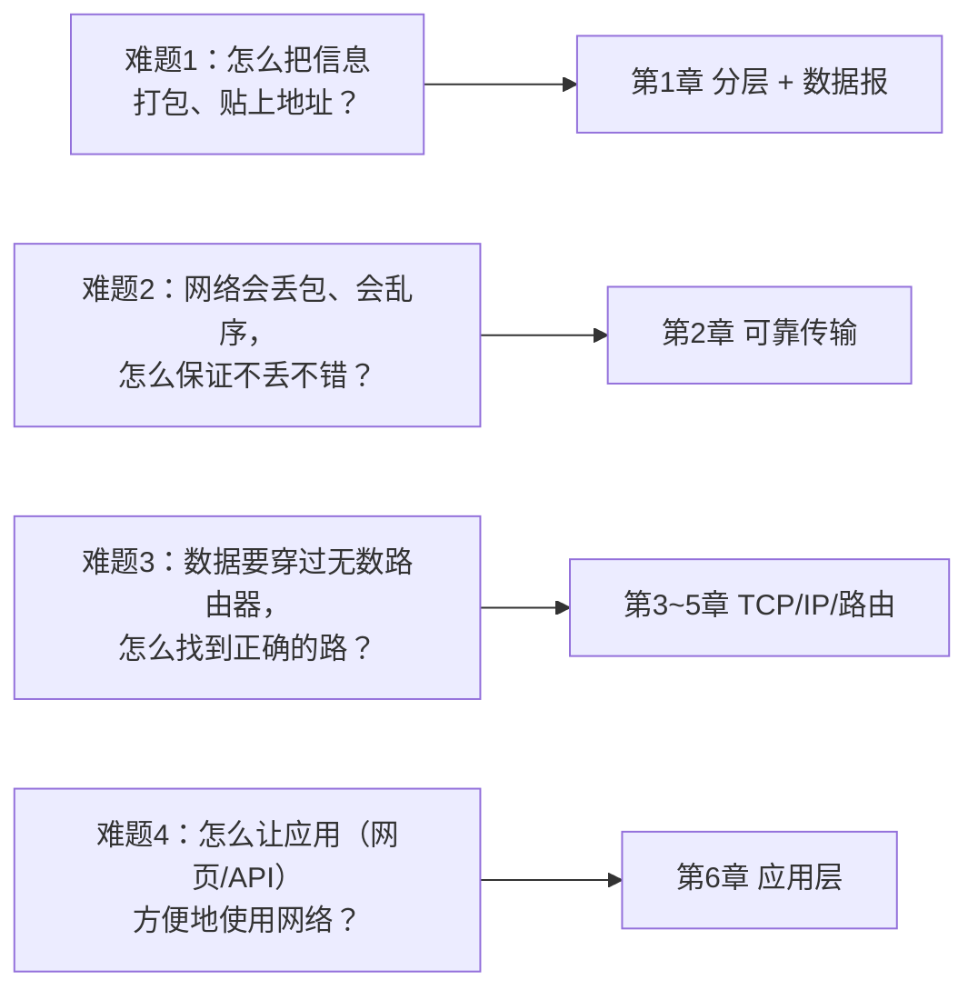

# 第 0 章：网络是什么 + 学习方法

> 本章目标：建立全局观，搞清楚「网络」到底在解决什么问题，以及我们该怎么高效学。

## 一、一个最简单的定义

**计算机网络 = 让两台（或多台）计算机之间能互相传递信息的系统。**

就这么简单。你在微信上发一条消息，本质上是：你的手机 → 穿过无数设备 → 到达对方手机。这一路上有无数个"接力点"，网络这门课就是在拆解这个"接力"是怎么完成的。

## 二、网络要解决的四个"硬骨头"

网络听起来简单（不就是传个消息吗？），但真正做起来有四个难题，这四道难题恰好对应了我们后面要学的章节：

| 难题 | 一句话 | 对应章节 |
|---|---|---|
| 1. 打包与寻址 | 信息要切成小块、标上"从哪来到哪去" | 第 1 章 |
| 2. 可靠性 | 网络天生会丢东西，要把它变得可靠 | 第 2、3 章 |
| 3. 找路 | 数据怎么穿越全球找到目的地 | 第 4、5 章 |
| 4. 好用 | 怎么让程序员轻松用网络 | 第 6 章 |

## 三、贯穿全书的核心思想（先记住这一条）

> **分层（Layering）+ 封装（Encapsulation）** 是网络设计的灵魂。

- **分层**：把复杂问题拆成几层，每层只解决一小块问题，互相不干扰。
- **封装**：数据像俄罗斯套娃一样，一层套一层，每层加上自己的"信封"信息。

第 1 章会详细展开，现在你只需要有个印象：**寄快递的流程**就是网络的分层模型。

## 四、高效学习方法（建议这样跟我学）

1. **先看图，再看字**：每章开头都有框架图，先花 30 秒看整体结构。
2. **抓住"为什么"**：不要死记协议细节，而是问"它要解决什么问题？"。理解了问题，答案自然就记住了。
3. **用类比记忆**：我会给每个概念配一个生活化的类比，帮你把抽象变具体。
4. **主动提问**：任何一点卡住都立刻问我，我会把问题和你当时的困惑**原样记进笔记**——这恰恰是笔记里最值钱的部分。
5. **联系你的工作**：每个知识点我都会标注「对 AI 工程师有什么用」。

## 五、本章自检（学完你应能回答）

- [ ] 网络是什么？它在解决什么根本问题？
- [ ] 网络的四大难题分别是什么？对应哪些章节？
- [ ] "分层"和"封装"这两个词大概是什么意思？
- [ ] 你为什么（作为 AI 工程师）需要学网络？

---

## 我不懂的点 & 问答记录

> （这里会随着我们互动不断补充，记录我的真实困惑和答案）

_（暂无——等你提问后我来补充）_
