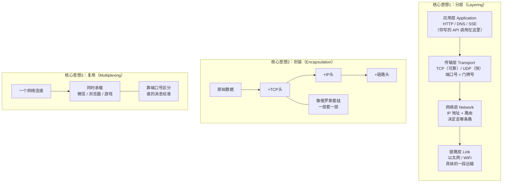
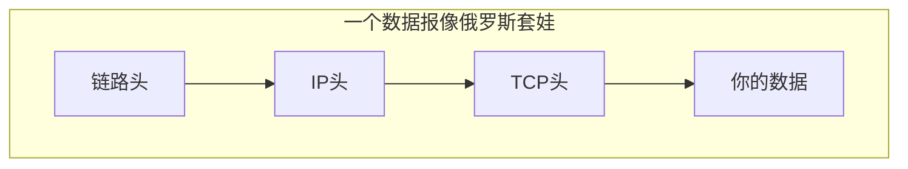
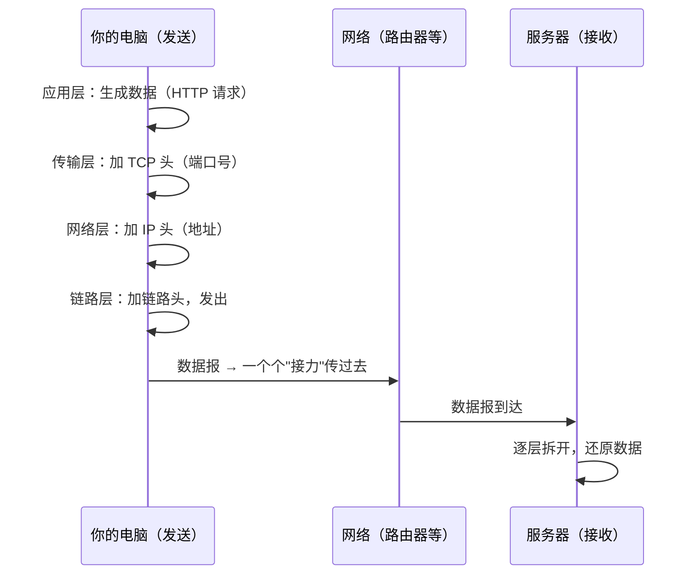

# 第 1 章：分层模型 + 数据报 / 封装 / 复用

> 本章目标：理解网络最底层的三个积木——**分层、封装、复用**。这是全书的地基，后面所有章节都建立在这上面。

## 一、知识框架图（先看这个）



## 二、核心思想 1：分层（Layering）

### 为什么分层？

网络太复杂了。如果让一个人（一段代码）同时处理"写网页""保证不丢包""找路""发信号"，会变成一坨无法维护的灾难。

**分层的本质：把大问题拆成小问题，每一层只管自己那一摊事，向上层提供"服务"，把脏活累活藏在自己内部。**

### 四层模型（TCP/IP 模型）

| 层 | 英文 | 职责 | 类比（寄快递） | 代表协议 |
|---|---|---|---|---|
| 应用层 | Application Layer | 你和程序之间的对话 | 你写的信的内容 | HTTP、DNS、SSE |
| 传输层 | Transport Layer | 保证"端到端"送达 | 快递公司承诺"送到+签收" | TCP、UDP |
| 网络层 | Network Layer（也叫 Internet Layer） | 寻址 + 找路 | 分拣中心看地址决定路线 | IP、BGP |
| 链路层 | Link Layer（也叫 Data Link Layer） | 相邻设备间的实际传输 | 卡车/飞机/快递员这一"段" | 以太网、WiFi |

> 记忆点：App=应用、Transport=运输、Network=网络、Link=连接/链路。

**层数缩写（读英文文档常用）：** 应用层=L7、传输层=L4、网络层=L3、链路层=L2。（OSI 七层模型比 TCP/IP 四层多一个最底下的**物理层 Physical Layer**，就是真正传 0/1 电信号的那层。）

> 关键：**每一层只和"相邻的层"打交道，不用关心其他层在干嘛。** 你写 HTTP 请求时，完全不用知道底层用的是 WiFi 还是网线——这就是分层的好处。

## 三、核心思想 2：数据报 & 封装（Datagram & Encapsulation）

### 什么是数据报（datagram）？

网络不是像打电话那样建立一条"专线"传数据，而是**把数据切成一小块一小块，每块打包成一个"包裹"（叫数据报 / packet），各自独立地送到目的地**。这种模式叫**分组交换**。

> 类比：你搬家不是雇一辆专车拉一整栋房子，而是把家当装进 N 个纸箱，每个纸箱贴上地址，分别发货。到达后再按编号拼回来。

### 什么是封装？

每个数据报在出发前，会被**一层层地套上"信封"（header）**。每层的 header 里写着该层需要的信息：

```
原始数据（比如你要发的 JSON）
  └─ 加上 TCP 头（端口号、序号等）      ← 传输层封装
       └─ 加上 IP 头（源地址、目标地址）  ← 网络层封装
            └─ 加上链路头（MAC 地址等）    ← 链路层封装
                 → 发送到物理线路上
```



到达目的地后，接收方再**一层层拆开**（解封装），每层只读自己的 header，处理完交给上一层。

### 具体例子（每一步长什么样）

假设你的电脑 IP=`192.168.1.100`、MAC=`AA:BB:CC:DD:EE:FF`、源端口 `52341`；目标 `api.openai.com`→IP `104.18.7.21`、端口 `443`。

```text
【第1层 应用层】你要发的 HTTP 数据
  POST /v1/chat/completions HTTP/1.1
  {"model":"gpt-4","messages":[...]}

【第2层 传输层】套上 TCP 头（含端口号）
  ┌ TCP头：源端口52341 → 目标端口443，序号seq=1001 ┐
  + 上面的 HTTP 数据

【第3层 网络层】再套上 IP 头（含 IP 地址）
  ┌ IP头：源IP 192.168.1.100 → 目标IP 104.18.7.21，协议TCP ┐
  + 上面的「TCP头+数据」

【第4层 链路层】最后套上以太网头（含 MAC）
  ┌ 以太网头：源MAC AA:BB:CC:DD:EE:FF → 目标MAC(你的路由器) ┐
  + 上面的「IP头+TCP头+数据」+ 校验码
```

**三个关键点：**
1. 每层只加自己关心的字段：TCP 加**端口**、IP 加 **IP 地址**、以太网加 **MAC**。
2. 发送"从里往外套"，接收"从外往里拆"。
3. 以太网头的"目标 MAC"写的是**你路由器**的 MAC（下一跳），不是最终服务器——因为链路层只管"送到相邻设备"，每跳换最外层信封、接力前进。

## 四、核心思想 3：复用（Multiplexing）

### 什么是复用？

**很多个应用、很多个会话，同时共享同一条网络连接**，却互不干扰。

> 类比：一栋楼只有一个街道地址（IP 地址），但里面有很多房间，每个房间住一户人家。快递送到楼下后，靠"房间号"送到正确的人手里。

这个"房间号"在传输层叫**端口号（port）**：

- 你的电脑 IP = 街道地址（网络层）
- 端口号 = 房间号（传输层）
- 浏览器用 80/443 端口、微信用别的端口……各走各的，互不串线

## 五、一张图串起三个思想（信息是怎么流动的）



## 六、对 AI 工程师有什么用

1. **你调 `openai.chat.completions.create()` 时**，底层就是：应用层（HTTP/HTTPS）→ 传输层（TCP）→ 网络层（IP）→ 链路层，四层各司其职。
2. **端口号**：你本地跑模型服务时经常看到 `127.0.0.1:8000`，那个 `8000` 就是端口号。理解了端口，你就理解了"为什么多个服务能在同一台机器上同时跑"。
3. **封装**：看懂数据包结构，是以后排查"请求发出去但对方收不到"的基础。
4. **分组交换**：理解它，你才会理解为什么网络有**延迟**和**丢包**——数据报不是走专线，是"拼车"。

## 七、本章自检

- [ ] 为什么网络要"分层"？四层分别叫什么、干什么？
- [ ] 什么是数据报（datagram）？什么是分组交换？
- [ ] 什么是封装？数据报从发出到接收经过了哪些"加头/拆头"步骤？
- [ ] 什么是复用？端口号的作用是什么？

---

## 我不懂的点 & 问答记录

> 记录我学习时的真实困惑与答案。

### Q1：我怎么知道我在用哪一层？我平时不就只发一个 API call 吗？

**答案：你不是"选择"某一层，而是四层同时自动都在跑，你只是只看得见最上面一层（应用层）。**

你调一次 API（`client.chat.completions.create(...)`）时，四层其实**全部自动运转**了：

| 层 | 谁在干 | 你要不要管 |
|---|---|---|
| 应用层 | 你写的代码 + SDK 生成 HTTP 请求 | ✅ 你只管这一层 |
| 传输层 | 操作系统自动建 TCP 连接（三次握手） | ❌ 自动 |
| 网络层 | 操作系统自动查 IP、找路 | ❌ 自动 |
| 链路层 | 网卡自动把数据变成信号发出去 | ❌ 自动 |

> 类比：寄信。你只写内容、投进邮筒；分拣、装车、空运这些"层"都自动发生，你不用管，但它们确实都发生了。分层只是**描述这趟旅程的一种方式**，不是你要做的选择题。

**那什么时候你才真正"碰到"下面几层？**

- 写 `0.0.0.0:8000` 让服务监听 = 碰到传输层（端口）+ 网络层（IP）
- 配置云上安全组放行端口 = 传输层
- 用 `ping` / `traceroute` 排查 = 网络层
- 用 `dig` 查域名 = 应用层（DNS）
- 网线拔了 / 连不上 WiFi = 链路层

**为什么还要学分层？** 两个原因：① 出问题时知道去哪一层找（见第 7 章排查框架）；② 做部署/排查等底层工作时，知道自己正在动哪一层。

### Q2：端口（port）是什么？一台电脑有多少个端口？是"一个 APP 一个端口"吗？

**答案：端口 = 一个数字（0~65535），是传输层用来标记"这份数据该交给电脑上哪个程序"的门牌号。**

- **端口不是物理的"洞"**，而是一个逻辑编号。
- 一台电脑总共有 **65536 个端口号**（0~65535）。
- **不是"一个 APP 一个端口"**，而是：
  - 一个 APP 可以占用**一个或多个**端口（网站服务监听 80、数据库监听 5432）。
  - 一个端口可以同时服务**成千上万个连接**（全世界的人同时连某网站 443 端口，服务器靠"来源 IP + 来源端口"区分不同的人）。

> 类比：IP 地址 = 整栋楼的街道地址；端口 = 楼里的房间号。快递送到楼下，看"房间号"决定送给哪户。

常用端口：`80`(HTTP)、`443`(HTTPS)、`22`(SSH)、`5432`(PostgreSQL)、`8000/8080`(开发服务器)。

**核心区分：IP 标识"哪台机器"，端口标识"机器上的哪个程序"。** `127.0.0.1:8000` = 本机这栋楼 + 8000 这个房间（你的模型服务）。

**实地考察（本机真实端口）：** 用 `lsof -nP -iTCP -sTCP:LISTEN` 能直接看到自己电脑正在监听的端口，例如：`127.0.0.1:8000`（本地模型服务 Python）、`127.0.0.1:3080`（网页 GUI node）、`14013~14023`（微信占了 5 个端口，证明"一个 APP 可以占多端口"）、`3306`（MySQL 默认端口）。
