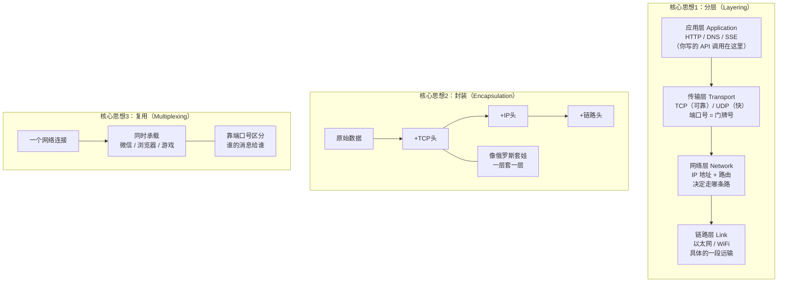
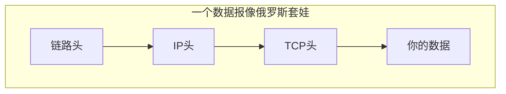
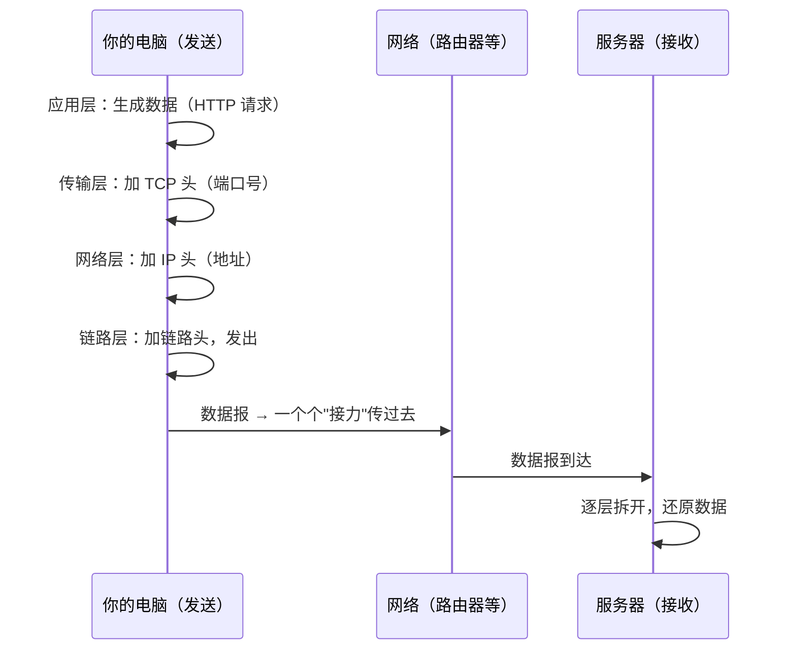

# 第 1 章：分层模型 + 数据报 / 封装 / 复用

> 本章目标：理解网络最底层的三个积木——**分层、封装、复用**。这是全书的地基，后面所有章节都建立在这上面。

## 一、知识框架图（先看这个）



## 二、核心思想 1：分层（Layering）

### 为什么分层？

网络太复杂了。如果让一个人（一段代码）同时处理"写网页""保证不丢包""找路""发信号"，会变成一坨无法维护的灾难。

**分层的本质：把大问题拆成小问题，每一层只管自己那一摊事，向上层提供"服务"，把脏活累活藏在自己内部。**

### 四层模型（TCP/IP 模型）

| 层 | 职责 | 类比（寄快递） | 代表协议 |
|---|---|---|---|
| 应用层 | 你和程序之间的对话 | 你写的信的内容 | HTTP、DNS、SSE |
| 传输层 | 保证"端到端"送达 | 快递公司承诺"送到+签收" | TCP、UDP |
| 网络层 | 寻址 + 找路 | 分拣中心看地址决定路线 | IP、BGP |
| 链路层 | 相邻设备间的实际传输 | 卡车/飞机/快递员这一"段" | 以太网、WiFi |

> 关键：**每一层只和"相邻的层"打交道，不用关心其他层在干嘛。** 你写 HTTP 请求时，完全不用知道底层用的是 WiFi 还是网线——这就是分层的好处。

## 三、核心思想 2：数据报 & 封装（Datagram & Encapsulation）

### 什么是数据报（datagram）？

网络不是像打电话那样建立一条"专线"传数据，而是**把数据切成一小块一小块，每块打包成一个"包裹"（叫数据报 / packet），各自独立地送到目的地**。这种模式叫**分组交换**。

> 类比：你搬家不是雇一辆专车拉一整栋房子，而是把家当装进 N 个纸箱，每个纸箱贴上地址，分别发货。到达后再按编号拼回来。

### 什么是封装？

每个数据报在出发前，会被**一层层地套上"信封"（header）**。每层的 header 里写着该层需要的信息：

```
原始数据（比如你要发的 JSON）
  └─ 加上 TCP 头（端口号、序号等）      ← 传输层封装
       └─ 加上 IP 头（源地址、目标地址）  ← 网络层封装
            └─ 加上链路头（MAC 地址等）    ← 链路层封装
                 → 发送到物理线路上
```



到达目的地后，接收方再**一层层拆开**（解封装），每层只读自己的 header，处理完交给上一层。

## 四、核心思想 3：复用（Multiplexing）

### 什么是复用？

**很多个应用、很多个会话，同时共享同一条网络连接**，却互不干扰。

> 类比：一栋楼只有一个街道地址（IP 地址），但里面有很多房间，每个房间住一户人家。快递送到楼下后，靠"房间号"送到正确的人手里。

这个"房间号"在传输层叫**端口号（port）**：

- 你的电脑 IP = 街道地址（网络层）
- 端口号 = 房间号（传输层）
- 浏览器用 80/443 端口、微信用别的端口……各走各的，互不串线

## 五、一张图串起三个思想（信息是怎么流动的）



## 六、对 AI 工程师有什么用

1. **你调 `openai.chat.completions.create()` 时**，底层就是：应用层（HTTP/HTTPS）→ 传输层（TCP）→ 网络层（IP）→ 链路层，四层各司其职。
2. **端口号**：你本地跑模型服务时经常看到 `127.0.0.1:8000`，那个 `8000` 就是端口号。理解了端口，你就理解了"为什么多个服务能在同一台机器上同时跑"。
3. **封装**：看懂数据包结构，是以后排查"请求发出去但对方收不到"的基础。
4. **分组交换**：理解它，你才会理解为什么网络有**延迟**和**丢包**——数据报不是走专线，是"拼车"。

## 七、本章自检

- [ ] 为什么网络要"分层"？四层分别叫什么、干什么？
- [ ] 什么是数据报（datagram）？什么是分组交换？
- [ ] 什么是封装？数据报从发出到接收经过了哪些"加头/拆头"步骤？
- [ ] 什么是复用？端口号的作用是什么？

---

## 我不懂的点 & 问答记录

> 记录我学习时的真实困惑与答案。

_（暂无——等你提问后我来补充）_
