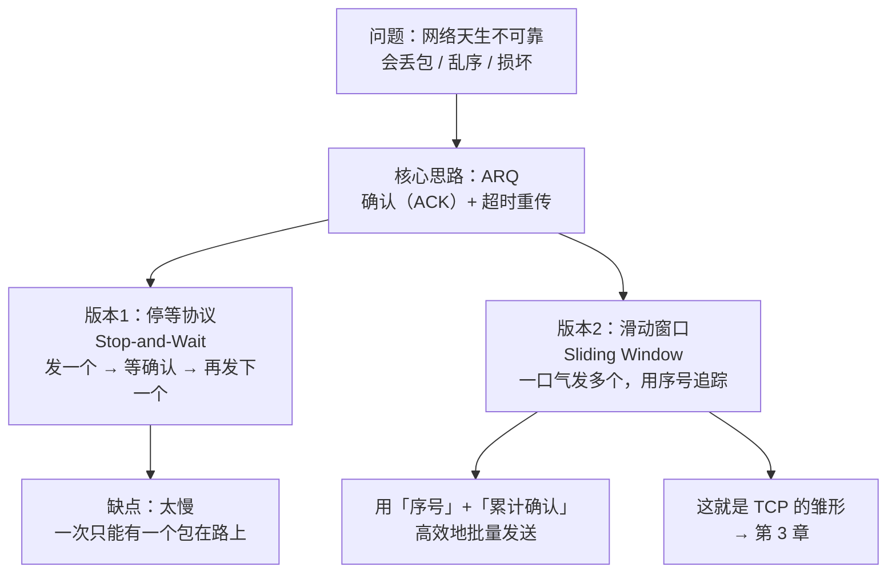
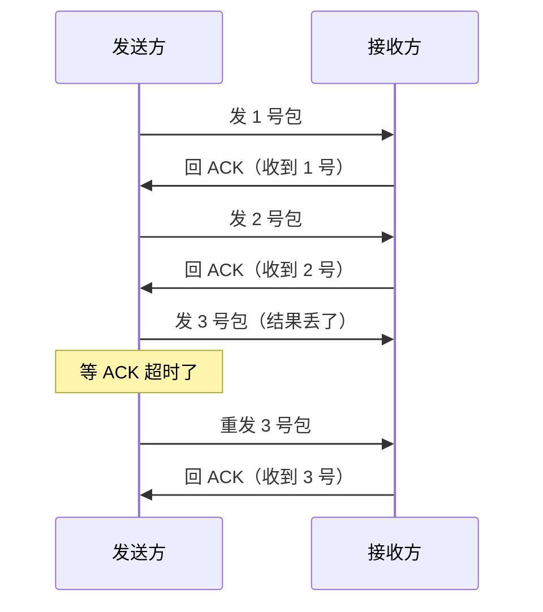
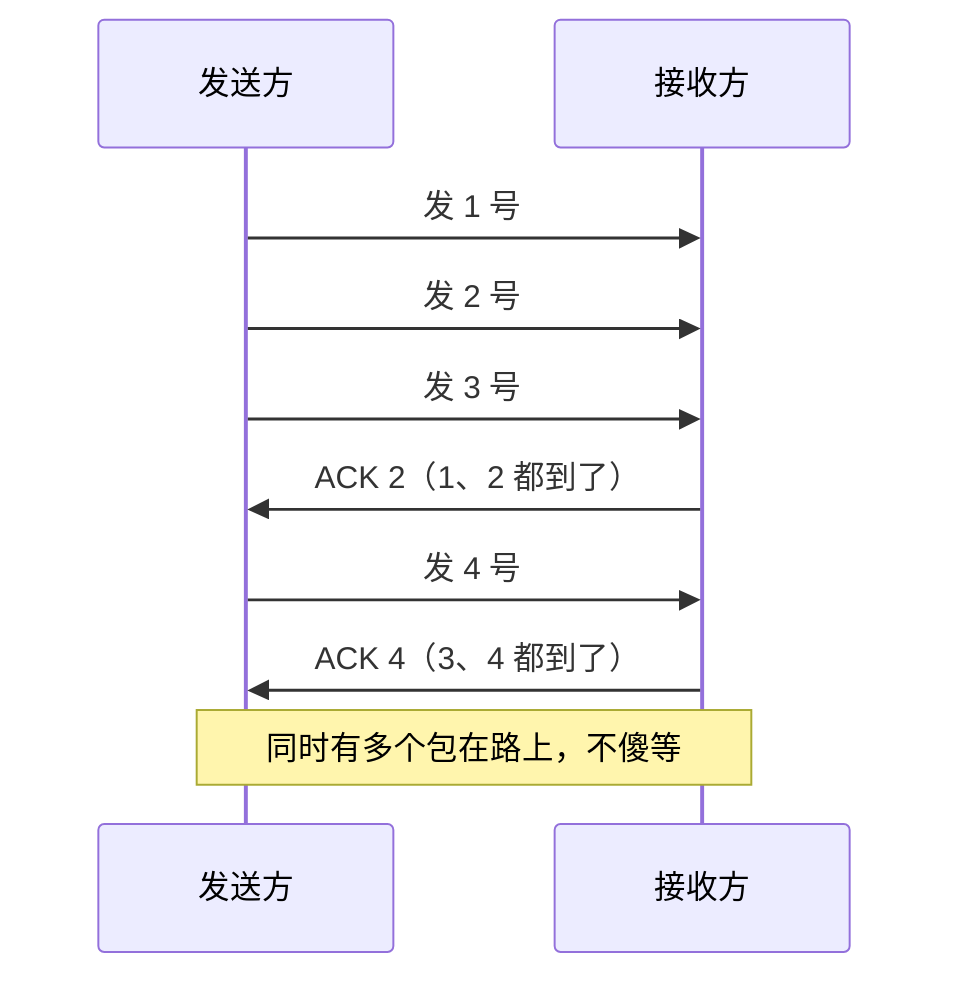

# 第 2 章：可靠传输（从不靠谱里造出靠谱）

> 本章目标：理解网络为什么"天生不可靠"，以及人们用了什么聪明办法，在不靠谱的网络上造出"可靠传输"。
> 这是后面 TCP（第 3 章）的思维铺垫，也是你理解"延迟、丢包、重试"的钥匙。

## 一、知识框架图（先看这个）

## 二、先认清问题：网络有多"不靠谱"？

网络（尤其是第 1 章讲的数据报那种"拼车"模式）会出这几种事：

| 故障 | 意思 | 类比 |
|---|---|---|
| **丢包** | 数据报在路上消失了 | 快递包裹丢了 |
| **乱序** | 后发的先到 | 你发了 1、2、3 号箱，结果 2 号先到了 |
| **损坏** | 内容传错了 | 包裹被压坏，字迹模糊 |
| **重复** | 同一个包收到两次 | 快递重复投递 |

**关键认知：网络只保证"尽力而为（best effort）"，不保证一定送到、顺序正确。** 这就像快递公司的普通快递——通常能到，但没人 100% 打包票。

那问题来了：我们要发一个文件、一条消息，**不能容忍它丢一半、顺序乱**。怎么办？

## 三、核心思路：ARQ（自动重传请求）

**ARQ = Automatic Repeat reQuest（自动重传请求）**，说白了就是两招配合：

1. **确认（ACK，Acknowledgment）**：接收方收到一个包，就回一个"收到啦"的收条。
2. **超时重传**：发送方等收条，如果**等太久没等到**（说明可能丢了），就**重发一遍**。

> 类比：挂号信 / 快递签收。你寄一封重要的信，要求对方签收；过了一周你还没看到签收回执，就重寄一封。这就是 ARQ 的全部精髓。

## 四、版本 1：停等协议（Stop-and-Wait）

最笨也最直观的可靠传输：

**规则：发一个包，必须等到确认，才发下一个。**

- 优点：简单、绝对可靠。
- **致命缺点：慢。** 想象一下，网络有 100 毫秒的延迟，那你每 100ms 才能发一个包，一秒钟最多发 10 个包，带宽全浪费在"等确认"上了。

> 类比：打电话时，每说一句话都要对方回一句"嗯我听到了"才能说下一句——太磨叽了。

## 五、版本 2：滑动窗口（Sliding Window）

停等太慢，改进思路是：**别傻等，一口气把好几个包先发出去**，用编号来追踪谁到了谁没到。

### 三个关键工具

1. **序号（Sequence Number）**：每个包编上号（1、2、3…）。接收方靠序号**排序**和**去重**。
2. **累计确认（Cumulative ACK）**：接收方回"我收到 5 号了"，意思是"**5 号及之前全部收到了**"。这样哪怕某个 ACK 丢了，也能从后面的 ACK 推断出来。
3. **窗口（Window）**：发送方允许"还在路上、没被确认"的包的最大数量。窗口越大，能同时飞在路上的包越多，效率越高。

### 为什么叫"滑动"窗口？

想象发送方手里有一个**框**，框里是"已发出但还没收到确认"的包。每当收到一个 ACK，这个框就**往右滑动**一格，腾出位置让新包进来。

> 类比：餐厅的"排队叫号"。你一口气叫了 10 个号，每完成一个顾客，窗口就往后挪一个号。

### 丢包了怎么办？

- 某个包丢了 → 发送方**等它的 ACK 超时** → **只重发那个丢失的包**（不用全重来）。
- 乱序了 → 接收方靠序号**重新排好**。

## 六、一张图总结：从不可靠到可靠

## 七、对 AI 工程师有什么用

1. **为什么接口有时慢**：你调大模型 API，底层走 TCP，天然要经历"序号 + 确认 + 可能的重传"。跨太平洋的往返延迟（RTT）本来就要 100~200ms，如果中间再丢包重传，就会更慢。
2. **为什么要做"重试（retry）"**：大模型 API 偶尔报超时，就是因为底层网络丢包/重传。所以工程上要做"指数退避重试"，这个思想根源就在 ARQ。
3. **为什么流式输出（SSE）是一个字一个字蹦出来**：因为它本质上是一条可靠的、有序的字节流——这正是"可靠传输"保证的"有序不丢"，第 3 章会展开。
4. **丢包 vs 延迟的区别**：你能判断"是网络慢（延迟）还是网络丢包（可靠性问题）"，排查问题时方向就对了。

## 八、本章自检

- [ ] 网络天生有哪几种"不靠谱"？
- [ ] ARQ 的两个核心动作是什么？
- [ ] 停等协议为什么慢？
- [ ] 滑动窗口靠什么实现"高效 + 可靠"？（序号、累计确认、窗口）
- [ ] 为什么叫"滑动"窗口？

---

## 我不懂的点 & 问答记录

> 记录我学习时的真实困惑与答案。

### Q1：为什么"分组交换"会有延迟和丢包？

**因为分组交换 = "尽力而为 + 共享道路"**（不给你开专用线路，而是把数据切成包、和大家拼车共享同一条路）。

**延迟来源：**
- 排队延迟（主因）：共享链路，路由器忙时你的包要排队等。
- 逐跳处理：每个路由器都要"收完整包→查表→转发"，每跳加一点时间。
- 传播延迟：光/电信号有速度上限，跨洋就是几十上百毫秒。

**丢包来源：**
- 缓冲区溢出（主因）：路由器队列满了，只能丢弃新来的包（这就是"拥塞"）。
- 传输损坏：信号干扰，校验失败被丢弃。
- TTL 到期：路由绕圈，转满次数被丢弃。

**对比：** 电路交换 = 专用车道（打电话独占，不堵不丢但浪费）；分组交换 = 公共道路（拼车，高效但会堵会丢）。

**闭环：** 正因为分组交换天生有延迟和丢包，才需要 TCP（第 2、3 章）用"序号+确认+重传+拥塞控制"在"不靠谱的拼车"上造出可靠传输。
