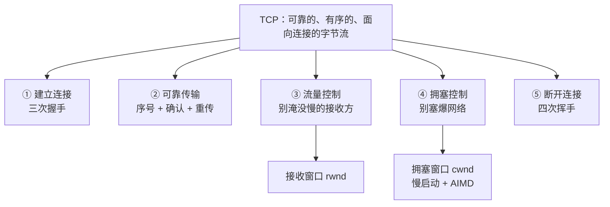
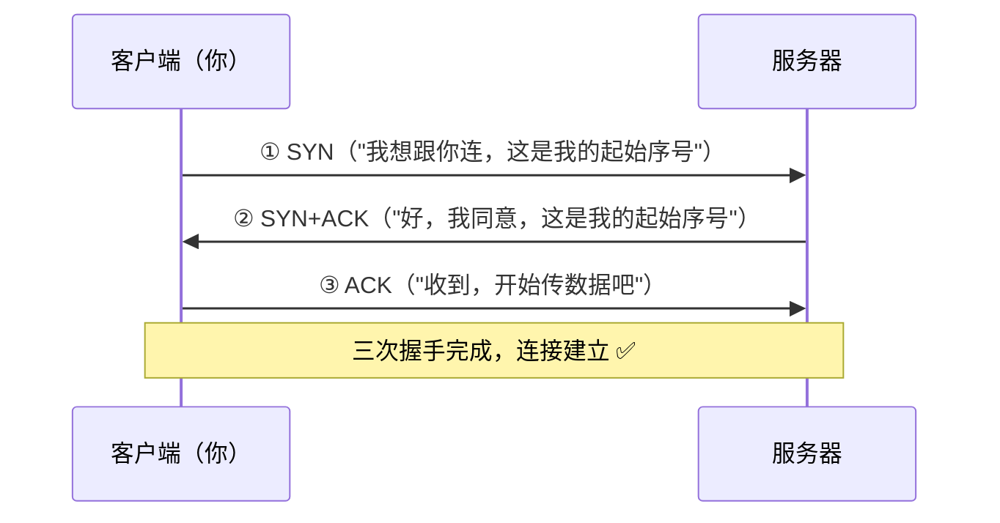
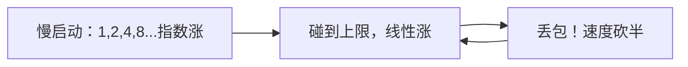
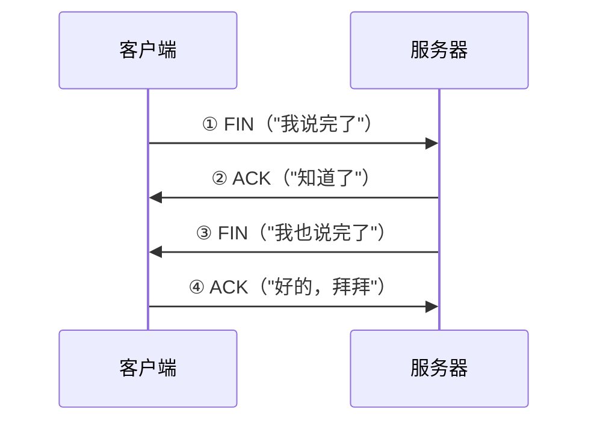

# 第 3 章：TCP 深入（互联网最核心的协议）

> 本章目标：搞懂 TCP 到底是什么、它怎么建立连接、怎么保证可靠，以及它为什么"时快时慢"。
> TCP 是你每天调 API、部署服务都在用的协议，是全书最值得吃透的一章。

## 一、知识框架图（先看这个）

## 二、TCP 是什么？（一句话 + 一个类比）

**TCP（Transmission Control Protocol，传输控制协议）= 在不可靠的网络之上，提供一条"可靠、有序、面向连接"的字节流。**

> 类比：**打电话**。
> 1. 先拨号、确认对方在听（**建立连接**）
> 2. 然后双方一句一句有来有回地聊（**可靠、有序传输**）
> 3. 最后说"拜拜"挂断（**断开连接**）

对比之下，另一种传输协议 **UDP** 就像**寄明信片**：不建立连接、不保证送到、不保证顺序，但**快**。两者各有用途，第 6 章会再对比。

## 三、① 建立连接：三次握手（Three-Way Handshake）

TCP 在正式传数据前，要先"确认双方都能通"。这个确认过程要交换三次消息，所以叫**三次握手**：

> 类比：打电话。
> ① 你："喂？"（SYN）
> ② 对方："喂，听得到吗？"（SYN+ACK）
> ③ 你："听得到，我开始了。"（ACK）
> 双方都确认"对方能听到我、我也能听到对方"，才正式开始。

**为什么是三次而不是两次？** 关键在客户端最后那个 ACK：它证明**双方都能收发**。如果是两次，服务器不确定客户端是否真的收到了它的回应。

## 四、② 可靠传输：序号 + 确认 + 重传

第 2 章的滑动窗口，TCP 完整实现了它：

- 每个字节都有**序号**，接收方按序组装、去重。
- 接收方回 **ACK**，表示"这个序号之前都收到了"（累计确认）。
- 发送方**超时没收到 ACK 就重传**。

> 这就是为什么流式输出（SSE）能保证"一个字一个字按顺序蹦出来、一个字都不丢"。

## 五、③ 流量控制（Flow Control）：别淹没慢的接收方

**问题**：发送方像机关枪一样猛发，但接收方（比如一台慢服务器、你的手机）处理不过来，缓冲区被撑爆 → 数据还是丢。

**解决**：接收方在 ACK 里附带一个数字——**接收窗口（rwnd）**，告诉发送方"我现在最多还能收这么多，别发超了"。

> 类比：对方边听边记笔记，说"你慢点，我快记不过来了"。发送方就放慢速度，等对方说"好了继续"再加快。

## 六、④ 拥塞控制（Congestion Control）：别塞爆网络

**问题**：即使接收方吃得下，**网络中间的路由器**也可能堵车。路就 4 车道，突然挤进来 1 万辆车，谁都走不动（这叫**拥塞**）。TCP 必须主动减速，否则大家一起堵死。

TCP 用两个经典机制自我调节：

1. **慢启动（Slow Start）**：连接刚建立时，先试探性地**少量发**，然后**指数级翻倍**地加，快速找到"大概能发多快"。
2. **拥塞避免 + AIMD（加性增、乘性减）**：
   - 没丢包 → 慢慢**线性增加**发送速度（+1）
   - 一丢包 → 立刻**砍半**（×0.5），再慢慢爬回去

> 类比：你在高速上不知道前面堵不堵，先慢慢加速，发现通畅就继续提速；一旦前面刹车（丢包），立刻减速，再慢慢加回去。**全世界的 TCP 连接都在自觉"礼让"，网络才不会集体崩溃。**

**发送速度最终由谁决定？** = **min(接收窗口 rwnd, 拥塞窗口 cwnd)**，取两者中更小的那个（既不能淹死接收方，也不能塞爆网络）。

## 七、⑤ 断开连接：四次挥手（Four-Way Teardown）

数据传完了，要礼貌地断开（因为连接是双向的，两个方向要各自关一次，所以是四次）：

## 八、TCP vs UDP 速查表

| | TCP | UDP |
|---|---|---|
| 连接 | 有（三次握手） | 无 |
| 可靠 | 可靠、有序 | 不保证 |
| 速度 | 相对慢 | 快 |
| 类比 | 打电话 | 寄明信片 |
| 典型用途 | 网页、API、文件、流式输出 | 视频通话、游戏、直播、DNS |

## 九、对 AI 工程师有什么用（重点！）

1. **为什么 API 第一次请求慢、之后快**：每次建连接都要三次握手（耗时一个往返 RTT）。所以要用 **连接复用 / keep-alive / 连接池**，避免频繁握手。
2. **为什么大模型输出是"流式"的**：SSE 走 TCP，字节流有序可靠，所以能一个字一个字实时推送。
3. **为什么下载速度忽快忽慢**：TCP 拥塞控制在动态调节，丢包就砍半——你看到的波动，就是 AIMD 在起作用。
4. **gRPC / HTTP/2 走 TCP，HTTP/3 走 UDP（QUIC）**：理解 TCP/UDP 的区别，你才能理解为什么新技术（如 QUIC）要另起炉灶用 UDP。
5. **排查"慢"的思维**：慢可能是「延迟高（握手/往返多）」也可能是「丢包（拥塞、重传）」，两者的解法完全不同。

## 十、本章自检

- [ ] TCP 的三个特点是什么？
- [ ] 三次握手是哪三步？为什么需要三次？
- [ ] 流量控制和拥塞控制分别解决什么问题？区别是什么？
- [ ] 慢启动和 AIMD 是什么？
- [ ] 发送速度最终由什么决定？
- [ ] TCP 和 UDP 的核心区别？

## 十一、自检答案速查

**① TCP 的三个特点？** 可靠的（Reliable）、有序的（Ordered）、面向连接的（Connection-oriented）字节流。

**② 三次握手？** ①SYN（"我想连你"）→②SYN+ACK（"同意+确认"）→③ACK（"确认，开始"）。三次是因为最后 ACK 证明双方都能收能发；两次的话服务器不确定客户端收到回应。

**③ 流量控制 vs 拥塞控制？** 流量控制=别淹死**接收方**（用 rwnd）；拥塞控制=别塞爆**网络**（用 cwnd）。一个管接收方，一个管网络。

**④ 慢启动和 AIMD？** 慢启动=连接初指数翻倍（1→2→4→8）快速探路；AIMD=加性增、乘性减（通畅+1、丢包砍半）。

**⑤ 发送速度由谁决定？** `min(rwnd, cwnd)`，取更小的那个。

**⑥ TCP vs UDP？** TCP 可靠/有序/面向连接/慢（打电话）；UDP 不可靠/无序/无连接/快（寄明信片）。

---

## 我不懂的点 & 问答记录

> 记录我学习时的真实困惑与答案。

### Q1：SYN 是什么？

**SYN = Synchronize（同步），是 TCP 报文头里的一个标志位（flag）。**

- **标志位（flag）**＝报文头里的一个"开关"，只能取"开(1)/关(0)"，用来发信号。就像信封上的标签贴纸。
- 常见标志位：`SYN`（想建立连接）、`ACK`（确认收到）、`FIN`（要断开）、`RST`（强制重置）。

**三次握手里 SYN 的用法：**
- ① SYN=1 → "我想连你"
- ② SYN=1 且 ACK=1 → "同意连 + 确认收到"
- ③ ACK=1 → "确认收到，开始"

**关键点：握手时这些包几乎没有"内容"，全靠标志位传达信号。** 类比打电话，靠"喂？""听得到吗？"这些语气词（=标志位）确认连通，SYN 就是"喂？"。

**为什么叫"同步"？** 握手时双方还要同步各自的"初始序号（sequence number）"——即"从哪个编号开始数"，SYN 包带上初始序号让双方对齐。

### Q2：rwnd 和 cwnd 的全称？拥塞窗口是什么？给个例子？

**全称：**
- **rwnd = Receive Window（接收窗口）**
- **cwnd = Congestion Window（拥塞窗口）**

**窗口是个什么数字？** 一个**字节数**，表示"任意时刻最多有多少字节已发出、但还没确认（在途/in flight）"的上限。它不是速度，是上限。

**rwnd（接收窗口）例子：** 接收方缓冲区还剩 8,000 字节 → 在 ACK 里告诉发送方 `rwnd=8000`，即"我最多还能收 8,000 字节"。

**cwnd（拥塞窗口）例子：** 发送方观察网络，估计"路上同时最多 6,000 字节不堵车" → 自定 `cwnd=6000`，即"我在途最多 6,000 字节"。

**最终上限 = min(rwnd, cwnd)：**

| 场景 | rwnd | cwnd | 取 min | 瓶颈 |
|---|---|---|---|---|
| 网络堵、接收方快 | 8000 | 6000 | 6000 | 网络(cwnd) |
| 网络好、接收方慢 | 2000 | 8000 | 2000 | 接收方(rwnd) |

> 一句话：**rwnd=接收方说"我还能收多少"，cwnd=发送方估"网络能扛多少"，取更小的那个作为在途上限。**

### Q3：AIMD 是什么意思？

**AIMD = Additive Increase, Multiplicative Decrease（加性增、乘性减）**，是 TCP 拥塞控制的核心算法：

| 动作 | 英文 | 时机 | 做法 |
|---|---|---|---|
| 加性增 | Additive Increase | 没丢包（通畅） | 每次慢慢 +1 |
| 乘性减 | Multiplicative Decrease | 丢包（堵车） | 立刻砍半 ×0.5 |

**为什么不对称？** 增加要慢（小心试探，别一下加过头）；减少要快（立刻缓解拥塞）。

**数字例子（锯齿 sawtooth）：** `1→2→...→8`（+1）→丢包→`4`（砍半）→`4→5→...→10`（+1）→丢包→`5`→… 形成"慢慢爬→突然掉一半→再爬"的锯齿曲线，这就是下载"忽快忽慢"的真相。

> 类比：高速开车，通畅慢慢踩油门（加性增），前面刹车立刻砍半减速（乘性减）。

**避免混淆：** AIMD 是"拥塞避免"阶段的规则；连接刚建立时用的是"慢启动 Slow Start"（指数翻倍 1→2→4→8），负责快速探路。
