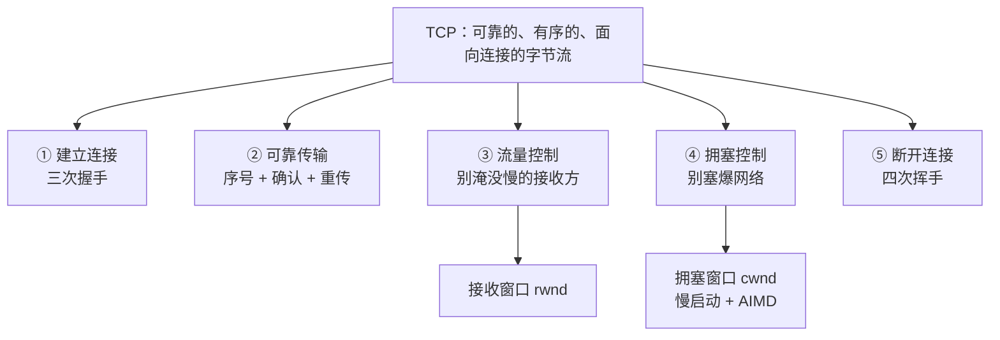
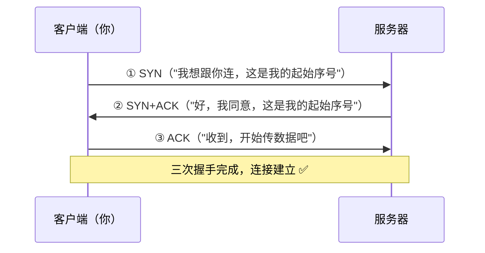
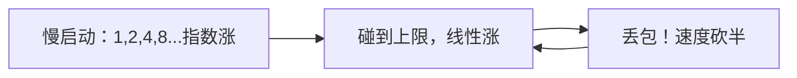
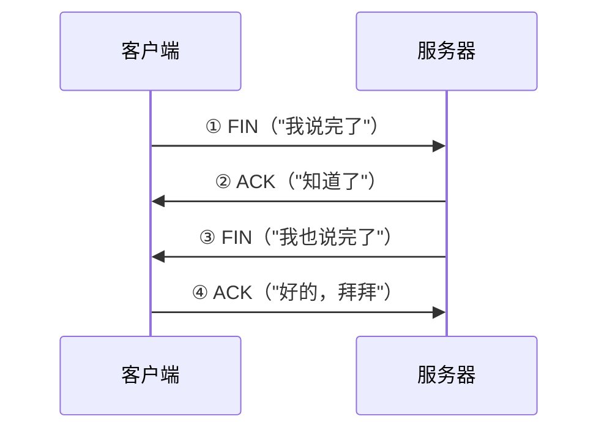

# 第 3 章：TCP 深入（互联网最核心的协议）

> 本章目标：搞懂 TCP 到底是什么、它怎么建立连接、怎么保证可靠，以及它为什么"时快时慢"。
> TCP 是你每天调 API、部署服务都在用的协议，是全书最值得吃透的一章。

## 一、知识框架图（先看这个）

## 二、TCP 是什么？（一句话 + 一个类比）

**TCP（Transmission Control Protocol，传输控制协议）= 在不可靠的网络之上，提供一条"可靠、有序、面向连接"的字节流。**

> 类比：**打电话**。
> 1. 先拨号、确认对方在听（**建立连接**）
> 2. 然后双方一句一句有来有回地聊（**可靠、有序传输**）
> 3. 最后说"拜拜"挂断（**断开连接**）

对比之下，另一种传输协议 **UDP** 就像**寄明信片**：不建立连接、不保证送到、不保证顺序，但**快**。两者各有用途，第 6 章会再对比。

## 三、① 建立连接：三次握手（Three-Way Handshake）

TCP 在正式传数据前，要先"确认双方都能通"。这个确认过程要交换三次消息，所以叫**三次握手**：

> 类比：打电话。
> ① 你："喂？"（SYN）
> ② 对方："喂，听得到吗？"（SYN+ACK）
> ③ 你："听得到，我开始了。"（ACK）
> 双方都确认"对方能听到我、我也能听到对方"，才正式开始。

**为什么是三次而不是两次？** 关键在客户端最后那个 ACK：它证明**双方都能收发**。如果是两次，服务器不确定客户端是否真的收到了它的回应。

## 四、② 可靠传输：序号 + 确认 + 重传

第 2 章的滑动窗口，TCP 完整实现了它：

- 每个字节都有**序号**，接收方按序组装、去重。
- 接收方回 **ACK**，表示"这个序号之前都收到了"（累计确认）。
- 发送方**超时没收到 ACK 就重传**。

> 这就是为什么流式输出（SSE）能保证"一个字一个字按顺序蹦出来、一个字都不丢"。

## 五、③ 流量控制（Flow Control）：别淹没慢的接收方

**问题**：发送方像机关枪一样猛发，但接收方（比如一台慢服务器、你的手机）处理不过来，缓冲区被撑爆 → 数据还是丢。

**解决**：接收方在 ACK 里附带一个数字——**接收窗口（rwnd）**，告诉发送方"我现在最多还能收这么多，别发超了"。

> 类比：对方边听边记笔记，说"你慢点，我快记不过来了"。发送方就放慢速度，等对方说"好了继续"再加快。

## 六、④ 拥塞控制（Congestion Control）：别塞爆网络

**问题**：即使接收方吃得下，**网络中间的路由器**也可能堵车。路就 4 车道，突然挤进来 1 万辆车，谁都走不动（这叫**拥塞**）。TCP 必须主动减速，否则大家一起堵死。

TCP 用两个经典机制自我调节：

1. **慢启动（Slow Start）**：连接刚建立时，先试探性地**少量发**，然后**指数级翻倍**地加，快速找到"大概能发多快"。
2. **拥塞避免 + AIMD（加性增、乘性减）**：
   - 没丢包 → 慢慢**线性增加**发送速度（+1）
   - 一丢包 → 立刻**砍半**（×0.5），再慢慢爬回去

> 类比：你在高速上不知道前面堵不堵，先慢慢加速，发现通畅就继续提速；一旦前面刹车（丢包），立刻减速，再慢慢加回去。**全世界的 TCP 连接都在自觉"礼让"，网络才不会集体崩溃。**

**发送速度最终由谁决定？** = **min(接收窗口 rwnd, 拥塞窗口 cwnd)**，取两者中更小的那个（既不能淹死接收方，也不能塞爆网络）。

## 七、⑤ 断开连接：四次挥手（Four-Way Teardown）

数据传完了，要礼貌地断开（因为连接是双向的，两个方向要各自关一次，所以是四次）：

## 八、TCP vs UDP 速查表

| | TCP | UDP |
|---|---|---|
| 连接 | 有（三次握手） | 无 |
| 可靠 | 可靠、有序 | 不保证 |
| 速度 | 相对慢 | 快 |
| 类比 | 打电话 | 寄明信片 |
| 典型用途 | 网页、API、文件、流式输出 | 视频通话、游戏、直播、DNS |

## 九、对 AI 工程师有什么用（重点！）

1. **为什么 API 第一次请求慢、之后快**：每次建连接都要三次握手（耗时一个往返 RTT）。所以要用 **连接复用 / keep-alive / 连接池**，避免频繁握手。
2. **为什么大模型输出是"流式"的**：SSE 走 TCP，字节流有序可靠，所以能一个字一个字实时推送。
3. **为什么下载速度忽快忽慢**：TCP 拥塞控制在动态调节，丢包就砍半——你看到的波动，就是 AIMD 在起作用。
4. **gRPC / HTTP/2 走 TCP，HTTP/3 走 UDP（QUIC）**：理解 TCP/UDP 的区别，你才能理解为什么新技术（如 QUIC）要另起炉灶用 UDP。
5. **排查"慢"的思维**：慢可能是「延迟高（握手/往返多）」也可能是「丢包（拥塞、重传）」，两者的解法完全不同。

## 十、本章自检

- [ ] TCP 的三个特点是什么？
- [ ] 三次握手是哪三步？为什么需要三次？
- [ ] 流量控制和拥塞控制分别解决什么问题？区别是什么？
- [ ] 慢启动和 AIMD 是什么？
- [ ] 发送速度最终由什么决定？
- [ ] TCP 和 UDP 的核心区别？

---

## 我不懂的点 & 问答记录

> 记录我学习时的真实困惑与答案。

_（暂无——等你提问后我来补充）_
