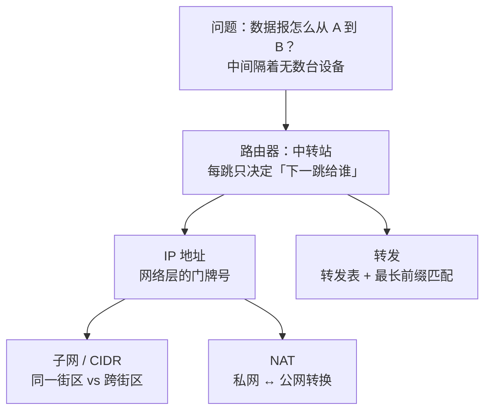

# 第 4 章：路由器 + IP 地址（数据怎么找到路）

> 本章目标：理解数据报是怎么"一跳一跳"穿越全球到达目的地的，以及 IP 地址、子网、NAT 这些你部署时天天见的概念。
> 这一章直接对应你云上部署会遇到的 VPC、CIDR、私网/公网 IP。

## 一、知识框架图（先看这个）



## 二、分组交换 & 路由器：一跳一跳地接力

数据报不是"一飞冲天"直达目的地，而是**像接力一样，经过一台台路由器，一跳（hop）一跳地往前传**。这叫**分组交换**。

> 类比：快递不直达，而是经过"你家网点 → 区中转站 → 市分拣中心 → … → 目的网点"多个中转站。每个中转站只看一眼地址，决定"下一站交给谁"，然后扔给下一站。

**关键认知：路由器只负责"把包送到更接近目的地的一跳"，它不关心最终结果，也不保证不丢。** 每台路由器内部有一张**转发表**，查表决定"下一跳"。

## 三、IP 地址：网络层的"门牌号"

- **IPv4** 是 32 位二进制数，习惯写成 4 段 0~255 的十进制，如 `192.168.1.1`。
- 每台连网的设备都有一个 IP 地址（网络层地址），路由器靠它寻路。

> 类比：IP 地址 = 街道地址。快递员（路由器）看地址决定往哪送。

### 常见地址你其实都见过

| 地址 | 含义 |
|---|---|
| `127.0.0.1` | 本机（localhost），自己访问自己 |
| `192.168.x.x` | 家里/公司局域网常见的私网地址 |
| `10.x.x.x` | 云上 VPC 常见的私网网段 |
| `8.8.8.8` | Google 的公共 DNS 服务器（公网地址） |

## 四、子网 & CIDR：地址怎么分组

IP 地址被分成两部分：**网络部分 + 主机部分**。

- 写法如 `192.168.1.0/24`，其中 `/24` 表示"前 24 位是网络，后 8 位是主机"。
- 同一个子网里的设备，可以**直接互相通信**（不用经过路由器）；跨子网就要走路由器。

> 类比：`/24` 就像"同一个街区"。同一街区内邻居直接串门，跨街区就要通过邮局（路由器）转发。

**云上你会常看到**：创建 AWS VPC 时要填 `10.0.0.0/16`，然后切成 `10.0.1.0/24`、`10.0.2.0/24` 等子网——这就是 CIDR 的实际应用。

## 五、路由器怎么转发：最长前缀匹配

路由器收到包，查转发表，看目的 IP **匹配哪条规则**。如果同时匹配多条，选**最具体（前缀最长）**的那条。

> 类比：分拣员看邮编，写"北京"和写"北京·海淀区·中关村"——肯定按更具体的"中关村"来分，而不是笼统的"北京"。

## 六、私网 vs 公网 + NAT

- **公网 IP**：全球唯一，直接能在互联网上找到你。
- **私网 IP**（`10.x`、`192.168.x`、`172.16~31.x`）：只在局域网内部有效，**不能直接出现在公网上**。

你家所有设备、云上一个 VPC 里的所有机器，通常都只有私网 IP。那它们怎么上网？靠 **NAT（网络地址转换）**：


> 类比：一栋写字楼，所有员工共享一个对外总机号码。对外打电话都显示总机号（NAT 转换），对内再用分机号（私网 IP）找人。

**这解释了**：为什么别人不能直接"找到"你家电脑或你云上的私网机器——因为它们藏在 NAT 后面，只有主动往外连才能被 NAT 记住并放行回来。

## 七、对 AI 工程师有什么用（重点！）

1. **`127.0.0.1:8000`**：你本地跑模型服务时这个地址 = 本机 + 端口 8000。理解了 IP + 端口，你就懂了"本地调试"。
2. **Docker / 容器网络**：每个容器在私网里，靠端口映射（`-p 8000:8000`）暴露出来——本质就是 NAT 的一种。
3. **云上 VPC / 子网 / 安全组**：部署模型服务时，你会在 VPC 里划子网、设安全组（允许哪些 IP/端口访问）。搞懂私网/公网/IP 地址，这些配置就不再是"照着教程乱填"。
4. **为什么部署的服务别人访问不到**：十有八九是——服务只监听了 `127.0.0.1`（本机），或安全组没放行端口，或它藏在 NAT/私网后面。
5. **traceroute / ping**：排查"连不上"时，你能理解这些工具在看什么——包走了哪些路由器（跳数）、哪一跳断了。

## 八、本章自检

- [ ] 数据报是怎么到达目的地的？（一跳一跳接力）
- [ ] IP 地址是什么？`127.0.0.1`、`192.168.x.x` 分别代表什么？
- [ ] `/24`、CIDR 是什么意思？
- [ ] 私网 IP 和公网 IP 的区别？
- [ ] NAT 是干什么的？为什么它让你"别人找不到你"？

## 九、自检答案速查

**① 数据报怎么到达目的地？** 一跳一跳接力——每台路由器查表、决定"下一跳"给谁，逐跳送到终点。

**② IP 地址是什么？** 网络层标识设备的地址。`127.0.0.1`=本机（自己访问自己）；`192.168.x.x`=局域网私网地址。

**③ /24、CIDR？** 表示"前 24 位是网络、后 8 位是主机"，用来把 IP 地址划分成子网。同一子网内设备可直接通信，跨子网要走路由器。

**④ 私网 vs 公网 IP？** 私网（10.x、192.168.x、172.16~31.x）只在局域网内有效；公网全球唯一、可直接在互联网上被找到。

**⑤ NAT？** 网络地址转换——把私网 IP 换成公网 IP 出去，回来再换回。因为你藏在 NAT 后面，别人无法直接"找到"你。

---

## 我不懂的点 & 问答记录

> 记录我学习时的真实困惑与答案。

### Q1：IP 地址到底是什么？

**答案：IP 地址 = 网络层用来"标识一台设备 + 把数据路由到它"的地址。**

- IPv4 是 32 位二进制，习惯写成 4 段 0~255 的数字，如 `192.168.1.100`。
- 类比：IP = **街道地址 / 电话号码**，标识"这栋楼（这台设备）"；端口 = 房间号，标识"楼里的哪个程序"。

**核心区分：IP 标识"哪台机器"，端口标识"机器上的哪个程序"。** 两者合起来 `IP:端口` 才是完整送达地址——先靠 IP 找到设备（网络层），再靠端口找到设备上的程序（传输层）。

> 一个直觉：把数据送到你电脑上某个程序，需要两步定位——先按 IP 找到你这台电脑，再按端口找到电脑里正确的那个程序。

### Q2：CIDR 是什么？主网和子网有区别吗？怎么判断设备在哪个子网？

**① CIDR = Classless Inter-Domain Routing（无类别域间路由）**，是一种"表示一段 IP 地址范围"的写法：`网络地址/前缀长度`。

`192.168.1.0/24` 的二进制含义：IP 是 32 位，`/24` 表示**前 24 位是网络部分、后 8 位是主机部分**，所以这个子网包含 `192.168.1.0 ~ 192.168.1.255` 共 256 个地址。

**② 主网 vs 子网没有本质区别，"子网"是相对的**——大网络切出的每一块，相对大网络就叫子网：

```
10.0.0.0/8（大网）→ 10.0.0.0/16（子网）→ 10.0.1.0/24（更小的子网）→ 10.0.1.5（单台设备）
```

**③ 区分大小看 `/N`：** `/N` 越小网络越大越上层，越大越小越具体（/8=1600万、/16=65536、/24=256、/32=1）。

**④ 判断两台设备是否同一子网：** 看它们的 IP "网络部分"（前缀覆盖的位）是否相同。`192.168.1.0/24` 下，`192.168.1.10` 和 `192.168.1.99` 同一子网，`192.168.1.10` 和 `192.168.2.10` 跨子网。

**⑤ 澄清：** 子网分组的是**设备**（网络层/IP），**程序**是靠端口区分（传输层）——两者不同层。正确说法是"哪些设备在哪个子网"，每台设备上的程序靠端口区分。

### Q3：最长前缀匹配是什么？

**最长前缀匹配（Longest Prefix Match）＝路由器在转发表里，找到所有匹配的规则后，选"最具体（前缀最长）"的那条。**

**前缀**＝`/N` 里的 N（网络部分的位数）。前缀越长越具体，越短越笼统。

**例子（转发表）：**

| 目的网络 | 前缀长度 | 下一跳 |
|---|---|---|
| `10.0.0.0/8` | 8 | 路由器 A |
| `10.1.0.0/16` | 16 | 路由器 B |
| `10.1.2.0/24` | 24 | 路由器 C |
| `0.0.0.0/0` | 0 | 默认网关（兜底） |

目标 IP = `10.1.2.50`，四条规则**都匹配**，但选前缀最长的 `/24` → 发路由器 C。因为 `/24` 最精确地指向 `10.1.2.x` 这个确切子网。

> 类比：邮编"中国/北京/海淀区/中关村"都匹配，选最具体的"中关村"。

**`0.0.0.0/0` 是默认路由（Default Route）**，前缀长度 0、最笼统的兜底，永远最后才轮到它。
