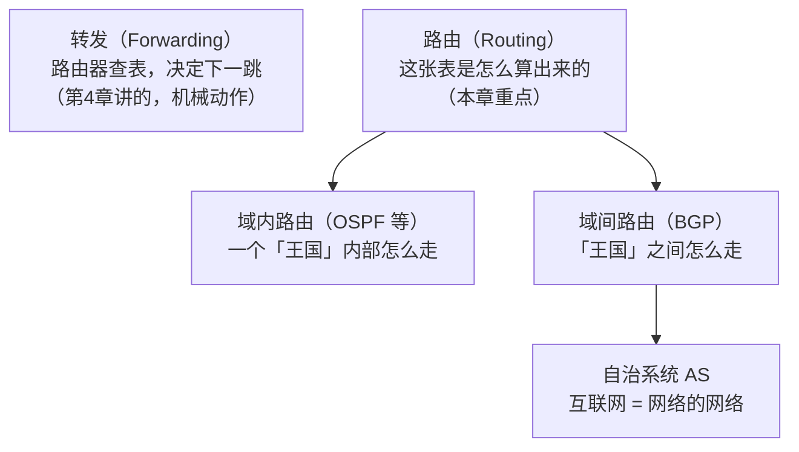

# 第 5 章：路由 & BGP（全球互联网是怎么连起来的）

> 本章目标：理解"转发"和"路由"的区别，以及全球互联网作为一个"网络的网络"，是怎么靠 BGP 把几十万个网络连成一张网的。
> 这一章偏"大局观"，帮你理解 CDN、地域延迟、以及新闻里常说的"互联网断网/BGP 事故"。

## 一、知识框架图（先看这个）

## 二、先分清两个词：转发 vs 路由

这是最容易混的一对概念，一句话区分：

- **转发（Forwarding）**：路由器收到包，**查表**决定"下一跳给谁"——是个**机械的、一毫秒内完成**的动作。（第 4 章的内容）
- **路由（Routing）**：这张"转发表"**本身是怎么算出来、怎么维护的**——是个**持续的、全网协作**的过程。（本章内容）

> 类比：
> - 转发 = 邮递员看到信封上的地址，机械地把信投进对应的格子。
> - 路由 = 邮局总部如何**规划全国的邮路图**（哪条路通、哪条路堵了要绕行），这张"地图"是怎么更新和同步的。

## 三、互联网 = 网络的网络（Network of Networks）

互联网不是"一个大网络"，而是**几十万个独立的网络**互相连起来。每个独立的网络叫一个**自治系统（AS，Autonomous System）**：

| 例子 | 是谁 |
|---|---|
| 中国电信、中国移动、AT&T | 运营商（ISP） |
| Google、Amazon、Microsoft | 大型互联网公司（也有自己的 AS） |
| 你的公司 / 学校 | 也可能有自己的 AS |

> 类比：每个 AS 就像一个国家（有自己的内部道路、自己的规则）。互联网 = 这些国家之间通过"边境口岸"互相连通。

**关键**：一个 AS 内部怎么走，是它自己的事（**域内路由**，用 OSPF 等协议）；AS 之间怎么走，需要大家约定一套"外交规则"——这就是 **BGP**。

## 四、BGP：自治系统之间的"外交协议"

**BGP（Border Gateway Protocol，边界网关协议）**，是 AS 之间交换"我能通往哪些网络"的协议。

每个 AS 通过 BGP 向邻居宣告（advertise）：**"我能到达 IP 网段 X、Y、Z，从我这走。"** 于是全球的路由信息像涟漪一样传播，最终每台路由器都能算出"去某个地址，大概该往哪个 AS 走"。

> 类比：国家之间建交，互相通报"从我这能通往哪些地区"。这些"外交信息"层层传递，最终形成一张全球通行地图。

**为什么你会听到"BGP 事故 / 互联网断网"**：因为 BGP 是"信任 + 宣告"机制，一旦某个 AS 错误地宣告了别人的网段（BGP 劫持，hijack），流量就会被错误地导走，造成大范围断网。这就是很多"某国断网""某云服务商故障"新闻背后的技术原因。

## 五、域内 vs 域间：一张图分清

| | 域内路由 | 域间路由 |
|---|---|---|
| 范围 | 一个 AS 内部 | AS 之间 |
| 协议 | OSPF / IS-IS | BGP |
| 类比 | 一个国家内部的道路规划 | 国家之间的外交与边境 |
| 谁管 | 每个 AS 自己 | 全网协作约定 |

## 六、对 AI 工程师有什么用

1. **地域延迟从哪来**：你在国内访问一个部署在美国的模型服务，数据要跨多个 AS、绕半个地球。理解 BGP，你就理解"为什么不同地域延迟差别那么大"——这是选机房区域（region）的底层原因。
2. **CDN 为什么快**：CDN（内容分发网络）就是利用 BGP/路由，把内容缓存到离用户最近的机房。理解路由，你就理解 CDN 的价值。
3. **Anycast（任播）**：像 `8.8.8.8` 这样的公共 DNS，全球多个机房用**同一个 IP**，BGP 会自动把用户路由到最近的那个。这是"全球部署"的高级技巧。
4. **看懂新闻**：再看到"互联网大面积故障"，你不再是一脸懵，而是知道"大概率是 BGP 层面的问题"。

## 七、本章自检

- [ ] 转发和路由的区别是什么？
- [ ] 什么是自治系统（AS）？为什么说互联网是"网络的网络"？
- [ ] BGP 是干什么的？
- [ ] 域内路由和域间路由分别用什么协议、管什么范围？
- [ ] 为什么会出现"BGP 劫持"导致的断网？

## 八、自检答案速查

**① 转发 vs 路由？** 转发=路由器查表决定下一跳（机械动作，毫秒级）；路由=这张转发表怎么算出来、怎么维护（持续协作过程）。

**② 自治系统 AS？** 互联网由几十万个独立网络（AS）连起来，所以叫"网络的网络"。每个 AS 像一个国家，有自己的内部规则。

**③ BGP？** AS 之间交换"我能到达哪些网段"的协议，让全球路由信息传播开来。

**④ 域内 vs 域间？** 域内路由用 OSPF（一个 AS 内部）；域间路由用 BGP（AS 之间）。

**⑤ BGP 劫持？** 某 AS 错误宣告了别人的网段，流量被错误导走，造成大范围断网。

---

## 我不懂的点 & 问答记录

> 记录我学习时的真实困惑与答案。

### Q1：为什么需要 BGP？给个具体例子？

**具体例子：** 你（中国电信的网络）要访问 Google 服务器，数据要跨过"电信 → 其他运营商 → Google"。电信的路由器怎么知道"去 Google 该往哪走"？

Google（AS15169）用 BGP 宣告"我能到达 8.8.8.0/24，从我这走"→ 宣告像涟漪传播 → 电信的路由器也知道了"去 8.8.8.0/24 往 Google 方向走"。

**为什么需要 BGP？** 互联网由约 10 万个独立网络（AS）组成、没有中央机构，AS 之间必须有一套共同语言互相通报"我能到达哪些网络"——这就是 BGP。

### Q2：到底有多少协议？每层协议是做什么的？

**协议分两大类：**
- **数据面协议（运货）**：给你的数据加 header、传输数据（TCP、UDP、IP、Ethernet）。
- **控制面协议（问路/建地图）**：不碰你的数据，设备之间互相通信建立规则（BGP、OSPF、ARP、DNS）。

**协议地图：**

| 层 | 协议 | 干什么 | 数据面/控制面 |
|---|---|---|---|
| 应用层 | HTTP/HTTPS | 网页/API | 数据面 |
| 应用层 | DNS | 域名→IP | 控制面 |
| 传输层 | TCP / UDP | 可靠/快速传输 | 数据面 |
| 网络层 | IP | 寻址+转发 | 数据面 |
| 网络层 | BGP / OSPF | 域间/域内路由 | 控制面 |
| 网络层 | ICMP | ping 探测 | 控制面 |
| 链路层 | Ethernet/WiFi | 相邻传输 | 数据面 |
| 链路层 | ARP | IP→MAC | 控制面 |

> 关键：BGP/OSPF 不会给你的数据加 header，它们是路由器之间"互相打电话"、建立转发表的幕后协议。
