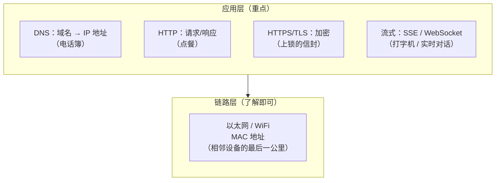
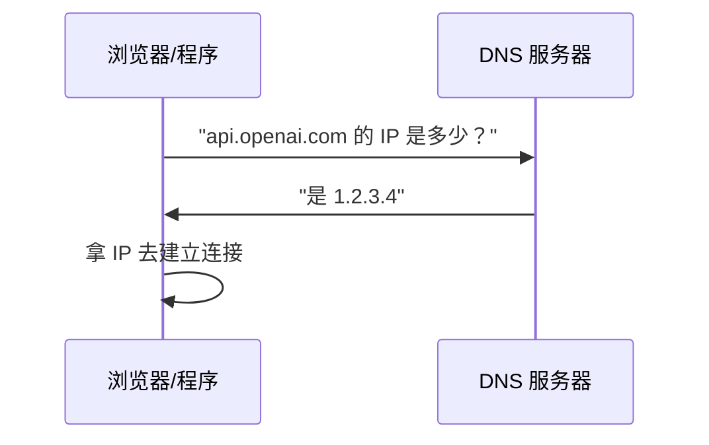
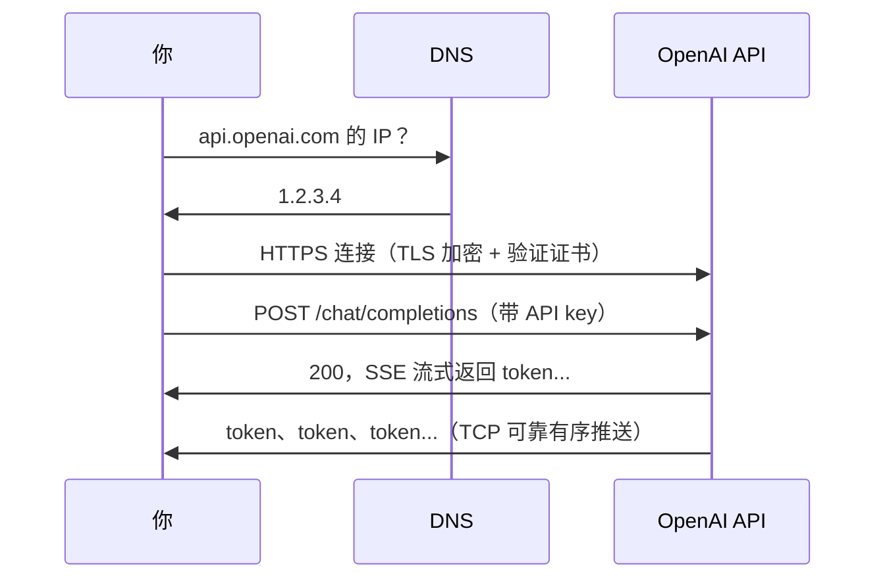

# 第 6 章：链路层 + 应用层（HTTP / DNS / TLS / 流式输出）

> 本章目标：理解离你最近的"最后一公里"（链路层，简单了解）和"应用层"（重点——HTTP、DNS、TLS、流式输出）。
> 应用层是你每天调 API、部署服务直接接触的层，是全书最实用的一章。

## 一、知识框架图（先看这个）



## 二、链路层（简单了解即可）

链路层管的是**相邻两个设备之间**的实际传输——"最后一公里"。

- 媒介：以太网（网线）、WiFi（无线）。
- **MAC 地址**：网卡出厂就有的物理地址（和 IP 地址是两回事：IP 是"门牌号"，MAC 是"网卡身份证"）。

> 类比：链路层 = 快递最后一程的"卡车/快递员"；MAC 地址 = 快递员认的"这栋楼的门牌"，IP 地址 = "这座城市里的地址"。跨段运输时，IP 不变（终点不变），但每段的 MAC 在变（每段快递员不同）。

**对 AI 工程师**：这一层几乎不用你操心，了解概念即可。

## 三、应用层重点 1：DNS（把名字翻译成地址）

你输 `api.openai.com`，但路由器只认 IP 地址（一串数字）。谁来做"名字 → 数字"的翻译？**DNS（域名系统）**。



> 类比：DNS = **114 查号台 / 电话簿**。你只知道人名，查一下得到电话号码，再拨号。

**对 AI 工程师**：
- 你访问不了某个服务，先问"是不是 DNS 解析不出来？"（`nslookup` / `dig` 就是干这个的）。
- CDN 常用 DNS 把同一个域名指向离用户最近的机房。
- 常见的 DNS 记录类型：`A`（域名→IP）、`CNAME`（域名→另一个域名）。

## 四、应用层重点 2：HTTP（请求 / 响应）

**HTTP（超文本传输协议）** 是应用层的老大，你调 API 本质就是在发 HTTP 请求。

**模型：一问一答（请求/响应）**。你发一个"请求"，服务器回一个"响应"。

> 类比：点餐。你递上菜单（请求），服务员端上菜（响应）。每道菜点一次，吃完再点下一道。

### 三个你必须会看的要素

**① 方法（Method）——你想干嘛**

| 方法 | 意思 | 对应 API 操作 |
|---|---|---|
| `GET` | 拿数据 | 查询 |
| `POST` | 提交数据 | 创建 / 调用大模型 |
| `PUT` / `PATCH` | 更新 | 修改 |
| `DELETE` | 删除 | 删除 |

**② 状态码（Status Code）——结果如何**

| 状态码 | 意思 | 你常在哪见到 |
|---|---|---|
| `200` | 成功 | 一切正常 |
| `301` / `302` | 重定向 | 换地址了 |
| `401` | 未认证 | API key 错误/缺失 |
| `403` | 禁止访问 | 没权限 |
| `404` | 找不到 | 路径写错 |
| `429` | 请求太频繁 | **限流！调大模型 API 常见** |
| `500` / `502` / `503` | 服务器错误 | 服务挂了 / 过载 |

> 💡 `429` 对你特别重要：调用 GPT/Claude 等 API 时，一旦超了速率限制就会收到它——所以工程上要做**重试 + 限速**。

**③ 请求头（Headers）——附带信息**

```http
POST /v1/chat/completions
Authorization: Bearer sk-xxxxx...   ← 你的 API key（身份凭证）
Content-Type: application/json       ← 告诉服务器"我发的是 JSON"
```

> 类比：Header 就像快递单上的备注栏（"易碎""到付""签名收"），服务器靠 `Authorization` 认出你是谁、靠 `Content-Type` 知道怎么解析你的内容。

## 五、应用层重点 3：HTTPS / TLS（加密）

HTTP 是**明文**的——你的 API key、聊天内容，别人在半路截获就能直接看到。所以有了 **HTTPS = HTTP + TLS 加密**。

**TLS 做两件事**：
1. **加密**：内容上锁，中间人看到的是乱码。
2. **验证身份**：确认你连的真是 `api.openai.com`，不是假的钓鱼服务器（靠**数字证书**，由 CA 权威机构签发）。

> 类比：HTTPS = 你寄一封**上了锁的信**，锁的钥匙只有收件人（服务器）有；同时信封上有"公证处"盖章，证明收件人身份是真的。

**对 AI 工程师**：
- 你所有 API 调用都应该走 `https://`（这保护你的 API key 不被窃取）。
- 看到浏览器报"**您的连接不是私密连接 / 证书错误**"，就是 TLS 验证身份这一步失败了——可能是证书过期、或你被劫持。

## 六、应用层重点 4：流式输出（SSE & WebSocket）

ChatGPT 那种"一个字一个字蹦出来"的效果，底层是两种技术：

| 技术 | 特点 | 类比 | 用途 |
|---|---|---|---|
| **SSE**（服务器推送事件） | 服务器单向持续推数据 | 电台广播（只收不发） | 大模型**流式输出** |
| **WebSocket** | 双向实时通信 | 打电话（双方都能说） | 聊天、实时协作 |

> 💡 你看到大模型"打字机式"输出，就是**服务器通过 SSE 走 TCP 这条可靠的字节流**，把 token 一个个推给你的浏览器/客户端。前面第 3 章学的 TCP"有序可靠"，在这里派上了用场。

## 七、对 AI 工程师的完整价值（一张图串起来）



**你调一次大模型 API，上面整条链路都在运转**：DNS 翻译 → TCP 三次握手 → TLS 加密握手 → HTTP 请求 → SSE 流式响应。你现在能看懂这条链路的**每一环**了。

## 八、本章自检

- [ ] DNS 是干什么的？类比是什么？
- [ ] HTTP 的请求/响应模型是什么？GET 和 POST 区别？
- [ ] 状态码 200 / 401 / 429 / 500 分别代表什么？
- [ ] HTTPS 和 HTTP 的区别？TLS 做哪两件事？
- [ ] SSE 和 WebSocket 的区别？大模型流式输出用的是哪个？

## 九、自检答案速查

**① DNS？** 把域名翻译成 IP 地址；类比电话簿/114 查号台。

**② HTTP 请求/响应模型？** 一问一答（点餐）。GET=拿数据，POST=提交数据（调大模型用 POST）。

**③ 状态码？** 200=成功、401=未认证（key 错）、429=限流、500=服务器错误。

**④ HTTPS vs HTTP？** HTTPS=HTTP+TLS 加密；TLS 做两件事：加密（内容上锁）+验证身份（证书）。

**⑤ SSE vs WebSocket？** SSE=服务器单向推（电台）；WebSocket=双向实时（打电话）。大模型流式输出用 SSE。

---

## 我不懂的点 & 问答记录

> 记录我学习时的真实困惑与答案。

### Q1：我一般只用应用层，那和网络交流时到底需要提供什么信息？

**答案：只需要提供 4 样东西，全部在应用层。**

一个 HTTP 请求就这 4 部分：

| # | 提供什么 | 是什么 |
|---|---|---|
| 1 | URL | 去哪里（域名 + 路径） |
| 2 | 方法 Method | 想干嘛（POST / GET…） |
| 3 | 请求头 Headers | 附带信息（身份、格式） |
| 4 | 请求体 Body | 要传的数据（JSON） |

**其余全部自动补全：**

| 你没提供 | 谁补 | 怎么补 |
|---|---|---|
| IP 地址 | DNS | 从 URL 域名解析 |
| 目标端口 | 默认规则 | `https://` 默认 443 |
| 自己的源端口 | 操作系统 | 自动分配随机端口 |
| MAC / 路由 | 底层协议 | 全自动 |

**关键洞察：URL 是"浓缩包"。** `https://` 定端口、域名被 DNS 解析成 IP、路径指明接口——你只写一个 URL，其实已间接提供了下面几层需要的种子信息。

> 一句话：站在应用层，你只需递出「URL + 方法 + 头 + 体」四样，下面的 IP、端口、握手、路由由网络系统按 URL 自动补全。

**逐行标注（一个 HTTP 请求长这样）：**

```http
POST https://api.openai.com/v1/chat/completions
Authorization: Bearer sk-xxxx...
Content-Type: application/json

{"model": "gpt-4", "messages": [...]}
```

| 行 | 属于哪部分 | 说明 |
|---|---|---|
| `POST` | **Method** | 第一个词，表示"要干什么" |
| `https://api.openai.com/...` | **URL** | 空格后面那一串，表示"去哪" |
| `Authorization: Bearer sk-...` | **Header** | 身份凭证（API key） |
| `Content-Type: application/json` | **Header** | 数据格式 |
| （空行） | 分隔线 | 表示"头结束，下面是正文" |
| `{"model":"gpt-4",...}` | **Body** | 真正要传的数据 |

> 固定格式：`方法 URL` + 若干行 `名字: 值`（头） + 一个空行 + 正文（体）。

### Q2：Header 里放的是"证书"信息吗？Body 就是"我想要什么"吗？

**① Header 里不放证书。** Header 是"关于这次请求的附注信息"：`Authorization`（API key/凭证）、`Content-Type`（数据格式）、`User-Agent`（客户端类型）、`Cookie`（会话）等。

**证书（certificate）是 TLS 握手阶段自动交换的**，和 header 是两码事：客户端先和服务器做 TLS 握手 → 服务器发证书 → 客户端验证身份 → 通过后才加密传输 HTTP 请求。你写代码时看不到、也不用管证书。

> 注意：`Authorization: Bearer sk-xxxx` 里的 `sk-xxxx` 是 **API key（身份凭证）**，不是证书。

**② Body 基本对，更准确说是"你发给服务器的正文数据（payload）"。** 调大模型时它装的就是"你想要什么"（`model`、`messages`）。补充：GET 请求通常没有 body（参数在 URL 里），POST/PUT 这类提交数据的请求才有 body。

### Q3：API key 是"告诉网络我是谁"吗？API key 和 Cookie 有什么区别？

**① 小纠正：API key 是告诉"服务器"你是谁，不是告诉"网络"。** 网络中间的路由器只把 key 当普通数据转发，看不懂也不关心；真正读 key 的是应用层另一端的服务器（查"这个 key 对应谁、有无权限、余额"）。

**② API key vs Cookie 对比：**

| | API key | Cookie |
|---|---|---|
| 谁用 | 程序调 API（机器对机器） | 浏览器登录网站（人对网站） |
| 谁发 | 你写代码主动放进 `Authorization` | 浏览器自动带（服务器发给你后自动回传） |
| 放哪 | `Authorization` 头 | `Cookie` 头 |
| 目的 | 证明"我有权调用"（常关联计费） | 记住"我是已登录用户"（维持会话） |
| 类比 | 门禁卡：每次主动刷卡 | 游乐园手环：戴一次，之后自动被认出 |

> 一句话：**API key = 你主动出示的"门禁卡"（每次调 API 都自己亮出来）；Cookie = 服务器给你戴上的"手环"（之后浏览器自动帮你亮出来，维持登录状态）。**

### Q4：TCP 是字节流（无边界），调 API 时靠什么控制"消息边界"？

**应用层协议自己发明边界机制，调 API 时主要靠三个：**

**① `Content-Length` 头（定长）：** 提前告诉你"正文正好 N 字节"，客户端精确读 N 字节就知道 body 结束。用于长度已知的响应（普通 JSON）。

**② `Transfer-Encoding: chunked`（流式分块）：** 流式输出长度未知，无法提前写 Content-Length。于是每块数据前先写"这块有多长（十六进制）"，客户端一块块读，直到遇到"长度 0"结束标记。

**③ SSE 双换行（`\n\n`）：** chunked 只解决"字节流怎么分段读"，SSE 再用"每个事件后跟空行"来切出一个个 token。

**串起来（调一次流式 API，三层边界同时工作）：**
```
① chunked 分块     → 字节流怎么一段段读
② SSE 双换行 \n\n  → 每段里怎么切出一个 token
③ JSON 花括号 {}   → 每个 token 里怎么解析字段
```

> 对应到代码：`for line in resp.iter_lines()`（按行读）→ `if line.startswith("data:")`（SSE 前缀）→ `json.loads(...)`（JSON 解析）。

### Q5：SSE 和 WebSocket 是什么？我什么时候用流式输出？

**SSE（Server-Sent Events，服务器推送事件）**＝服务器通过一条 HTTP 连接持续往客户端"推"数据，**单向**（服务器→客户端）。

- 你调大模型 API 的"打字机输出"就是 SSE：代码写 `stream=True`，服务器把一个个 token 推给你（`data: {"token":"你"}` → `data: [DONE]`）。
- 类比：电台广播（只收不发）。

**WebSocket**＝一条**双向**的持久连接，客户端和服务器都能随时互发消息，低延迟。

- 用于在线聊天（微信网页版/Discord）、实时协作（Google Docs）、实时游戏、股票交易。
- 类比：打电话（双方都能说）。

**对比：**

| | SSE | WebSocket |
|---|---|---|
| 方向 | 单向（服务器→客户端） | 双向 |
| 基于 | HTTP | 独立协议（从 HTTP 升级） |
| 场景 | 大模型流式输出、推送通知 | 在线聊天、实时协作 |

> 一句话：**SSE=服务器单向"广播"（流式输出用），WebSocket=双向"打电话"（聊天/协作用）。**
