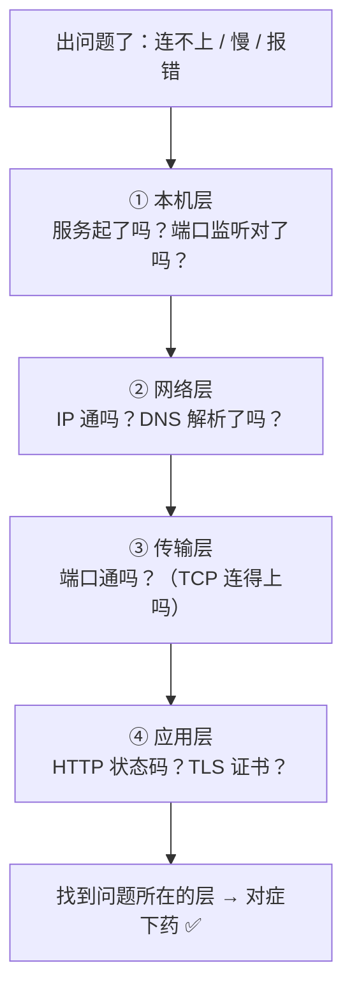
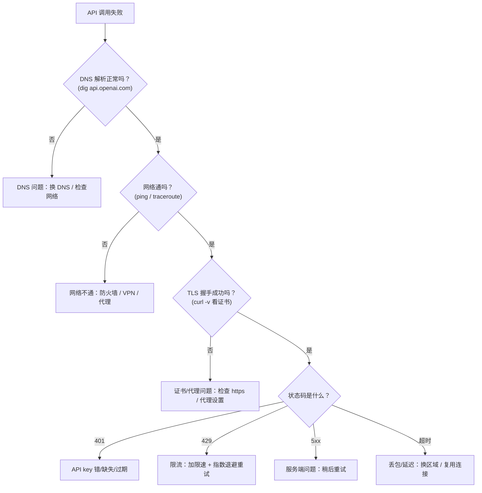

# 第 7 章：实战排查思维框架（学以致用）

> 本章目标：把前 6 章的知识，变成一套你排查网络问题时的"决策树"和"肌肉记忆"。
> 学完这章，你遇到"连不上 / 慢 / 报错"时，能快速判断问题出在哪一层。

## 一、核心思路：用分层模型来"定位"问题

排查网络问题的第一原则：**别瞎猜，按分层模型一层层排除。**

> 类比：快递没收到，你会从近到远排查——先看是不是自己没下单（本机），再看地址写对没（网络层），再看有没有到你们小区（传输层），最后看对方签收没（应用层）。

## 二、三类最常见问题 & 对应层

| 症状 | 最可能的问题层 | 关键排查点 |
|---|---|---|
| **连不上** | 本机层 / 网络层 | 服务没起、端口没放行、IP/防火墙、DNS |
| **慢** | 传输层 / 网络层 | 延迟高（往返多）、带宽小、丢包重传 |
| **报错** | 应用层 | 状态码 4xx/5xx、TLS 证书、认证 |

## 三、诊断工具速查表（你的"工具箱"）

| 工具 | 测哪一层 | 一句话用途 |
|---|---|---|
| `curl -v URL` | 应用层 | 看 HTTP 请求/响应的完整过程（最常用！） |
| `ping IP` | 网络层 | 看"通不通"、往返延迟 |
| `traceroute IP` | 网络层 | 看包走了哪几跳、断在哪一跳 |
| `nslookup / dig 域名` | 应用层(DNS) | 看域名解析出的 IP 对不对 |
| `telnet IP 端口` / `nc -vz` | 传输层 | 看某个端口通不通 |
| `netstat -an` / `ss` | 本机层 | 看本机哪些端口在监听 |

> 💡 对 AI 工程师，**`curl -v` 是最重要的一个**——它能把 DNS → TCP → TLS → HTTP 整个链路的过程都打印出来，一眼定位卡在哪。

## 四、针对"调大模型 API"的排查流程（最实用）

调用 GPT/Claude 等 API 报错时，按这个顺序排查：

## 五、五个"最高频"的坑（先记住这些）

1. **服务只监听 `127.0.0.1`**：别人访问不到，因为只允许本机访问。要让外部访问，得监听 `0.0.0.0`。
2. **安全组 / 防火墙没放行端口**：云上最常见的"访问不了"原因。
3. **DNS 解析缓存**：改了解析却还是连旧的，先 `dig` 看看解析到哪了。
4. **API key 放进了 URL 或明文日志**：应该放 Header 的 `Authorization`，且走 HTTPS。
5. **没有连接复用**：每个请求都重新三次握手 + TLS 握手，导致"为什么这么慢"。

## 六、一套万能排查口诀

> **先近后远，自下而上：先看自己（本机），再看路（网络），再看门（端口），最后看屋里的东西（应用）。**

遇到问题别慌，默念这句话，一层层排除，大部分问题 5 分钟内能定位。

## 七、对 AI 工程师的最终价值

学完这一整套，你获得的是**一套心智模型**：

- 看到 `429` → 知道是限流，做重试；
- 看到 `401` → 知道是认证问题，查 key；
- 看到"连接超时" → 知道可能是丢包/延迟/防火墙；
- 看到"证书错误" → 知道是 TLS 验身失败；
- 部署服务"访问不到" → 知道查监听地址、安全组、NAT。

**你已经从一个"照着教程乱试"的人，变成了一个"能定位问题在哪一层"的人。** 这正是高手和普通人的分水岭。

## 八、本章自检

- [ ] 排查网络问题应遵循什么思路？
- [ ] "连不上 / 慢 / 报错"分别最可能对应哪一层？
- [ ] `curl -v`、`ping`、`dig` 各测什么？
- [ ] API 返回 401 / 429 / 5xx 分别该怎么处理？
- [ ] "服务别人访问不到"最常见的三个原因？

---

## 我不懂的点 & 问答记录

> 记录我学习时的真实困惑与答案。

_（暂无——等你提问后我来补充）_
