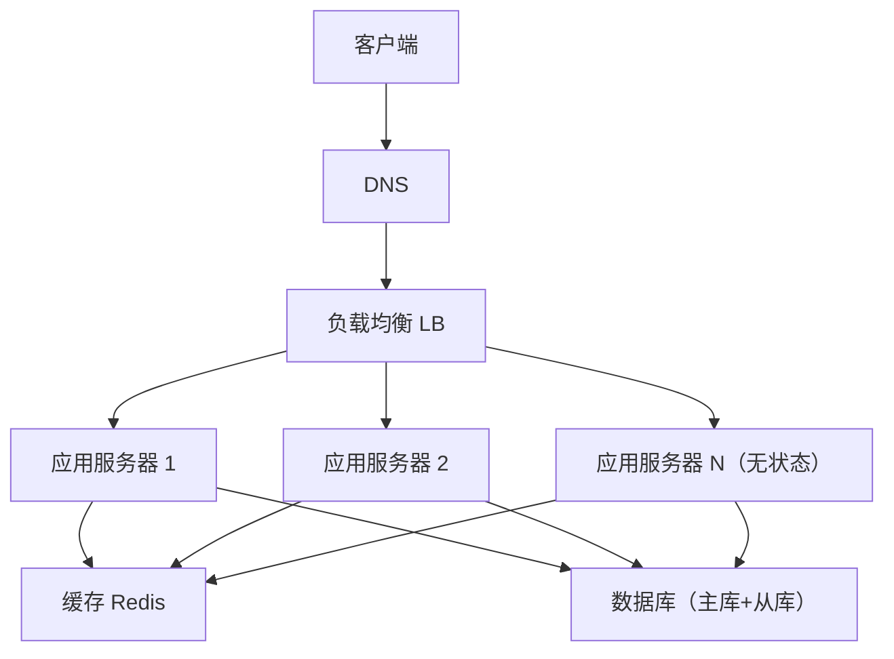

# 第 8 章：System Design 入门 + URL 短链接案例

> 本章目标：把前 7 章的网络知识，应用到"设计一个系统"上。学会 system design 的思考模板，并通过一个 URL 短链接案例，走完设计全过程。
> 这是 AI 工程师面试和工作中的核心能力。

## 核心计算机概念（零基础地基）

### 内存 vs 磁盘（理解一切的根源）

| | 内存（RAM） | 磁盘（Disk/SSD） |
|---|---|---|
| 速度 | 极快（纳秒级） | 慢（毫秒级，慢约 1000 倍） |
| 大小 | 小（几 GB~几百 GB） | 大（几 TB~几百 TB） |
| 断电 | 数据丢失 | 数据保留 |
| 价格 | 贵 | 便宜 |

> 类比：书桌（内存，小但随手拿）vs 仓库（磁盘，大但要跑过去找）。

### 数据库、缓存、索引、副本分别是什么

- **数据库**＝数据"永久保存"的地方（在磁盘上）。全量、持久、慢。类比：仓库里的书库。
- **缓存（Cache）**＝把"最常访问的热点数据"复制一份放**内存**。快、临时、只存热点。类比：书桌上常翻的几本书。
- **索引（Index）**＝数据库内部的"目录"，加速查找，避免全表扫描。类比：书的目录。
- **副本（Replica）**＝数据库的"复制品"。主库（Primary）管写，从库（Replica）管读，多个从库分散读压力。类比：复印多本书。

**读数据流程：** 先问缓存 → 命中直接返回（快）；未命中去数据库查，顺便存进缓存。

**为什么内存小还够当缓存？** 缓存只存"热点"那几 GB，不是全部 91TB，所以内存虽小但够用。

### key-value 就是字典（哈希表）

key-value pair 就是**字典**——Python 叫 `dict`、Java 叫 `HashMap`、数据结构课叫**哈希表（Hash Table）**，都是同一个东西：一个 key 对应一个 value。

数据库的"键值存储"（Redis）本质就是**字典的超级放大版**：

| | 程序里的 dict | Redis 键值数据库 |
|---|---|---|
| 大小 | 受内存限制 | 巨大（跨多台机器，几 TB） |
| 持久化 | 断电就丢 | 持久保存 |
| 谁能访问 | 自己程序 | 多台服务器共享 |

> 洞察：数据结构（哈希表/字典）→ 放大+持久化+分布式 → 键值数据库（Redis）→ 用来扛热点读。数据库底层不过是个"大字典"。

### 读多写少为什么这样解决

读多写少（短链接，读 11.5万/秒）的瓶颈是"读"，所以：
- 加**缓存**（热点放内存，读直接命中，不查磁盘）；
- 加**读副本**（复制多份，分散读压力）；
- 加**索引**（加速数据库查找）。

> 缓存、副本、索引本质都在解决同一件事：让"读"更快、更能扛。

---

## 一、System Design 思考模板（7 步）

| 步骤 | 做什么 | 用到的知识 |
|---|---|---|
| ① 需求澄清 Requirements | 功能要什么？多少用户？延迟/一致性？ | 沟通 + 判断 |
| ② 规模估算 Back-of-envelope | 算 DAU、QPS、存储、带宽 | 数学估算 ← scale 核心 |
| ③ API 设计 API | 方法、URL、参数、返回 | HTTP |
| ④ 数据模型 Data Model | 存什么、用什么数据库 | SQL/NoSQL |
| ⑤ 高层架构 High-Level | 画架构图 | 负载均衡、CDN、缓存 |
| ⑥ 深入设计 Deep Dive | 挑关键组件深入 | 技术选型 |
| ⑦ 瓶颈 & 扩展 Scaling | 怎么 scale 到亿级 | 水平扩展、分片、CDN |

> 顺序：**先澄清需求 → 估算规模 → 定 API → 定数据 → 画架构 → 深入 → 谈扩展**。第 2 步"估算"和第 7 步"扩展"就是 scale。

### 面试官视角：会问什么、怎么回答

**面试官考察 5 个能力：** ① 需求澄清（会不会主动反问）；② 结构化思考（按套路一步步来）；③ 技术广度（LB/缓存/数据库/CDN/MQ）；④ 权衡能力（CAP、一致性 vs 可用性）；⑤ 估算能力（QPS/存储）。

**核心：面试官要的是"思考过程"，不是"标准答案"。**

**回答心法：主动引导，按 7 步走，每步给"结论 + 权衡"。**

- 第 1 步：反问需求（功能 + 非功能 + 规模）。不反问直接画图是大忌。
- 第 2 步：估算规模（QPS、存储）。
- 第 3 步：定 API（方法、URL、状态码）。
- 第 4 步：定数据模型（存什么、什么结构、什么数据库）。
- 第 5 步：画架构（LB → 缓存 → 数据库 → CDN）。
- 第 6 步：深入关键点（短码生成算法、缓存设计）。
- 第 7 步：谈扩展（瓶颈 + scale）。

**每步都要带"为什么 + 权衡"**，例如：选 NoSQL 因为核心是键值对、读多要水平扩展；选最终一致因为新链接几秒内生效没关系。

### "Scale"（服务亿万用户）到底 scale 什么？

三个维度的爆炸式增长：

```
① 流量爆炸：亿万用户 → 每秒几百万请求（QPS）
   解法 → 负载均衡 + 水平扩展
② 数据爆炸：亿万用户 → 海量数据
   解法 → 缓存 + 分库分表
③ 地理分布：用户遍布全球 → 延迟要低
   解法 → CDN + 就近部署
```

---

## 术语速查表 & 数据库类型

### 关键术语（中英对照）

| 中文 | 英文 | 解释 |
|---|---|---|
| 日活 | DAU（Daily Active Users） | 每天活跃用户数 |
| 每秒查询数 | QPS（Queries Per Second） | 每秒处理多少请求 |
| 每秒事务数 | TPS（Transactions Per Second） | 每秒完成多少事务 |
| 负载均衡 | Load Balancer（LB） | 把请求分发到多台服务器 |
| 缓存 | Cache | 热点数据放内存 |
| Redis | Remote Dictionary Server | 远程字典服务器，基于内存的键值存储，最常用做缓存 |
| 内容分发网络 | CDN | 就近缓存内容 |
| 副本 | Replica | 数据库的复制品 |
| 主库/从库 | Primary / Replica | 主库写、从库读 |
| 索引 | Index | 数据库的目录，加速查找 |
| 分片 | Sharding | 数据切分到多台机器 |
| 水平扩展 | Horizontal Scaling（Scale out） | 加更多台机器 |
| 纵向扩展 | Vertical Scaling（Scale up） | 把单台机器变强 |
| 重定向 | Redirect | 跳转到另一个地址 |
| 键值对 | Key-Value | 一个 key 对应一个 value |
| 单点故障 | SPOF（Single Point of Failure） | 一处挂全挂 |
| 高可用 | HA（High Availability） | 服务几乎不挂 |
| 消息队列 | Message Queue（MQ） | 缓冲写请求 |
| 幂等 | Idempotent | 重复执行结果不变 |

### 数据库类型

| 类别 | 代表 | 适合什么 |
|---|---|---|
| SQL（关系型） | MySQL、PostgreSQL | 结构化、要事务、要 join（订单/账户） |
| NoSQL-键值 | Redis、DynamoDB | 简单映射（短码→长链接），超快 |
| NoSQL-文档 | MongoDB | JSON 文档、schema 灵活 |
| NoSQL-列族 | Cassandra、HBase | 海量写入、时序数据（监控/IoT） |
| NoSQL-图 | Neo4j | 关系复杂的数据（社交网络/推荐） |
| NoSQL-搜索 | Elasticsearch | 全文搜索 |

> NoSQL 不是某个数据库，而是"非关系型"这一大类。key-value 用 NoSQL 键值库（Redis），因为键值对正是它的设计目标，且易水平扩展。

### 事务 + 关系型 vs 键值型 + Cache 的本质

**事务（Transaction）**＝一组操作要么全成功、要么全失败（不可分割）。如转账 = A 扣钱 + B 加钱，必须同生共死。事务有 ACID 特性（原子性、一致性、隔离性、持久性）。关系型数据库擅长事务，所以钱/订单用 SQL。

**为什么 key-value 不是关系型？** "关系型"指数据用**表格**存、表之间有**关系**（外键/join）。键值型只是"key→value"简单映射，没有表、没有关系。

**Cache 不只是 key-value！** Cache 是"把慢存储的热点数据放快存储、加速访问"的**概念/角色**，存什么取决于场景：

| Cache 类型 | 缓存什么 |
|---|---|
| Redis | key-value（短链接映射、计算结果） |
| CDN | 图片、视频、JS 文件 |
| 浏览器缓存 | 网页、图片、CSS |
| DNS 缓存 | 域名→IP 映射 |

> Redis 只是实现 cache 的**一种工具**（存 key-value）；CDN、浏览器缓存也是 cache（存文件）。Cache 是"角色"，Redis 是"实现"。

**深层真相：所有缓存本质都是 key→value 映射。** CDN 也用 key（URL 路径）来找文件：

| 缓存 | key | value |
|---|---|---|
| Redis | 短码 Ab3X9 | 长链接字符串 |
| CDN | URL 路径 /image.png | 文件内容 |
| 浏览器缓存 | URL | 网页/图片 |
| DNS 缓存 | 域名 | IP |

**"快"的来源不同：** Redis 快靠**内存**（比磁盘快）；CDN 快靠**地理近**（比源站近）。"key"负责"怎么找到数据"，"快"来自"数据离你近/存储更快"。

### 水平 vs 纵向扩展 + 分片

- **纵向扩展（Scale up）**＝把单台机器变强（加 CPU/内存），有上限。类比：把一个人练成大力士。
- **水平扩展（Scale out）**＝加更多台机器，几乎无限。类比：雇更多人。互联网大厂都用水平扩展。
- **分片（Sharding）**＝把数据切分到多台机器，每台存一部分（按 key 哈希决定去哪台）。类比：图书馆按字母 A-Z 分 26 个书架。

**分片策略：** ① 哈希分片（hash(key) % N，最常用、分布均匀，但加机器要重新哈希）；② 范围分片（按 key 范围，范围查询方便但可能热点）；③ 目录分片（查目录表定位，灵活但多一次查询）；④ 地理分片（按地区）。URL 短链接用哈希分片。

**分片自动吗？** MySQL 不自动（要自己写分片逻辑/中间件）；NoSQL（DynamoDB/Cassandra/MongoDB）自动分片（内置）。这也是数据量大时选 NoSQL 的原因之一。

**分多少片？** 分片数 ≈ 总数据量 / 单机容量（再按性能、预留增长调整）。一片 ≈ 一台机器（或一个数据库实例）。

**Hash 是什么？** 一个函数，把任意输入变成固定长度的"指纹"（输入任意→输出定长、确定性、不同输入通常不同输出）。类比：指纹。

**为什么 hash 重要？** 因为能实现 O(1) 常数时间查找（最快）。数组 O(n)、二叉搜索树 O(log n)、哈希表 O(1)。

**用 hash 的数据结构：** HashMap/哈希表/字典、HashSet、布隆过滤器。

**HashMap 是什么？** HashMap = 哈希表 = 字典 dict，**同一个数据结构的三种叫法**（Python 叫 dict、Java 叫 HashMap、数据结构课叫哈希表）。"Map（映射）"是抽象概念（key→value），HashMap 是用"哈希"实现它的一种方式。

**底层长什么样：** 数组（桶）+ 哈希函数 + 链表（处理碰撞）。存数据 hash(key) 算出该放数组哪一格；查数据 hash(key) 直接跳过去拿，所以 O(1) 瞬间找到。两个 key 撞同一格用链表串起来。

**HashMap 解决什么？** 给定 key 瞬间找到 value。场景：缓存、去重、计数、分片路由（hash % N）、负载均衡、索引。

**去重怎么用 hash？** 用 HashSet，O(1) 判断"元素在不在集合里"——在则重复跳过，不在则加入。

**计数怎么用 hash？** HashMap 的 value 存次数：`count[key] = count.get(key, 0) + 1`（O(1) 找到 +1）。用于统计点击次数、点赞数。

**负载均衡和 hash 的关系（区分两个维度）：** L4/L7 是"看什么信息"（传输层 vs 应用层）；分发算法（轮询/最少连接/哈希）是"怎么决定发给谁"——两者是独立维度。哈希路由 = hash(key) % N 决定去哪个服务器，好处是同一 key 总是去同一台服务器（会话保持、缓存命中率高）。

**纠正"余数最多10个"：** `hash(key) % N` 的 N 是分片数，可设任意值（%3→3片、%100→100片、%1000→1000片）。hash 值本身是大数，% N 得 0~N-1，N 多大就能分多少片。

**L4 vs L7 信息区别：** L4 看 IP+端口（源IP/目标IP/源端口/目标端口，谁和谁通信）；L7 看 HTTP 内容（URL路径/方法/Headers/Body，请求的是什么）。

**为什么只看 L4/L7？** L2（MAC）只在相邻设备有效、太底层没用；L3（IP）已被 L4 涵盖（L4 本就含 IP）；所以负载均衡要么 L4（快、够用），要么 L7（智能、能按内容路由）。

**分片存磁盘还是内存？** 分片本身是"数据分布策略"、不是存储介质。数据库分片（主库 91TB）存**磁盘**（持久）；缓存分片（Redis Cluster）存**内存**（快）。看分的是数据库还是缓存。

---

## 二、核心概念澄清（问答记录）

### Q1：QPS 和 TPS 是什么？

- **QPS（Queries Per Second，每秒查询数）**＝系统每秒处理的"请求/查询"数量，偏"读"。
- **TPS（Transactions Per Second，每秒事务数）**＝每秒完成的"事务"数量，偏"写"/业务。

| | QPS | TPS |
|---|---|---|
| 衡量 | 每秒请求/查询数 | 每秒事务数 |
| 粒度 | 细（一次查询） | 粗（一组操作=1个业务） |
| 偏向 | 读 | 写/业务 |

> 一个事务（1 TPS）内部可能包含几次查询（几次 QPS）。相关术语：RPS（≈QPS）、并发数、RT/延迟。

### Q2：负载均衡是什么？L4/L7 和 IP/端口/HTTP 的关系？

**负载均衡（Load Balancing）＝把大量请求分发到多台服务器，让它们均摊工作量。** 类比：餐厅分桌。

- **L4 负载均衡（传输层）**：只看 **IP + 端口**，不打开 HTTP。快但"粗"。类比：快递分拣员看地址。
- **L7 负载均衡（应用层）**：会解析 **HTTP 内容**（URL/header/cookie），能按内容智能路由。类比：前台服务员听你说话。

| | L4 | L7 |
|---|---|---|
| 看什么 | IP + 端口 | HTTP 内容 |
| 懂 HTTP | 不懂 | 懂 |
| 速度 | 快 | 慢一点 |

### Q3：可用性、延迟、一致性是什么？

- **可用性（Availability）**＝服务"在线不挂"的程度，用"几个9"衡量（99.99% = 一年只挂 52 分钟）。
- **延迟（Latency）**＝响应快不快（响应时间，毫秒）。
- **一致性（Consistency）**＝数据各处是否一致（强一致 vs 最终一致）。

> 可用性 ≠ "能不能反复用"，而是"服务有多少时间正常在线"。

### Q4：为什么可用性和一致性常常矛盾？（CAP 定理）

**矛盾只在"多台服务器 + 网络断了"时出现。** 例子：2 台服务器 A、B 都存"余额=100"，网络断了无法同步：

- 用户 1 在 A 取款 → A 变 50；
- 用户 2 在 B 查余额 → B 还停留在 100。

B 只能二选一：
- **可用性优先**：回答"余额=100"（旧数据）→ 可用但**不一致**（会超取）。
- **一致性优先**：拒绝回答"暂无法确认"→ **一致**但暂时不可用。

> **CAP 定理：一致性(C)、可用性(A)、分区容错(P)最多同时满足两个。** 网络分区不可避免，所以只能在 C 和 A 之间二选一。

### Q5：为什么服务会宕机？怎么保证不宕机？

**宕机原因（不可避免）**：硬件故障、软件 bug、过载、网络故障、人为失误、依赖故障、天灾、攻击。

**关键认知：单台机器一定会挂，所以"高可用"不是造不坏的机器，而是"冗余"。**

消除**单点故障（SPOF）**的方法：多副本、多机房/多地域、故障转移、健康检查、数据复制、监控告警。

> 类比：飞机多个引擎（冗余）vs 单引擎车（单点故障）。

### Q6：为什么模板里没有"数据结构"这一步？

"数据结构"不是被遗漏，而是藏在**第 4 步（数据模型）+ 第 6 步（深入设计）**里。

- 算法题的"数据结构"＝数组/链表/哈希表/树/堆/图（代码内部组织数据）。
- 系统设计的"数据结构"＝存储选型（键值对/关系表/文档/图），体现在数据模型和存储选型。

### Q7：怎么提高可用性？怎么提高一致性？

**提高可用性（核心：冗余 + 消灭单点故障）：**

| 方法 | 怎么做 |
|---|---|
| 多副本 | 服务跑 N 台机器，负载均衡分发 |
| 多机房/多地域 | 服务部署在多个机房、城市 |
| 故障转移 | 主节点挂了自动切备用 |
| 健康检查 | 不健康的机器自动摘除 |
| 数据复制 | 数据存多份 |
| 自动扩容 | 流量暴涨自动加机器 |
| 优雅降级 | 核心挂了，降级提供部分功能 |

**提高一致性（核心：让副本尽快同步、同步前不给旧数据）：**

| 方法 | 怎么做 |
|---|---|
| 同步复制 | 主库写入后，等从库同步完才返回成功 |
| 共识协议 | Paxos/Raft，写要大多数节点确认 |
| 分布式事务 | 2PC 两阶段提交，保证多节点原子性 |
| 单一主库 | 所有写走一个主库，避免冲突 |
| 版本号/乐观锁 | 检测"有没有人改过我读的数据" |

**关键：两者方向相反（CAP 的体现）：**

```
提高可用性 → 任何时候都响应 → 可能返回旧数据 → 牺牲一致性
提高一致性 → 数据永远正确   → 要等同步、可能拒绝 → 牺牲可用性
```

**按业务权衡：**

| 业务 | 优先谁 | 为什么 |
|---|---|---|
| 银行转账/支付 | 一致性 | 钱不能错 |
| 点赞数 | 可用性 | 稍不准没关系，但不能点不动 |
| 商品库存 | 一致性 | 超卖出大事 |
| 短链接/新闻 | 可用性 | 短暂旧数据没关系 |

### Q8：一致性和延迟是同一个东西吗？"延迟越低一致性越高"对吗？

**不对，而且方向常常相反。** 延迟和一致性是**两个不同维度**：

| | 延迟 | 一致性 |
|---|---|---|
| 衡量 | 速度（快不快） | 正确性（对不对） |
| 是什么 | 数字（毫秒） | 状态（一致/不一致） |

**为什么方向相反？** 强一致需要"等所有副本同步"，而"等"就是慢：

```
要强一致 → 等同步 → 慢（高延迟）
要低延迟 → 不等同步立刻响应 → 可能返回旧数据（低一致性）
```

**例子：** A、B 两台服务器断网，A 上改了名字，B 还是旧的：
- B 立刻回答旧名字 → 延迟低、一致性低；
- B 等同步后再回答 → 延迟高、一致性高。

**补充：** 只有"多副本需要同步"时两者才打架；单台服务器（无副本）时它们完全独立。

> 一句话：延迟=速度、一致性=正确性，两个独立维度；分布式里常常此消彼长，不是"延迟低=一致性好"。

### Q9：读多写少 和 写多读少 的系统有什么不同？

**读多写少（Read-heavy）**：数据"写一次、读无数次"。例子：短链接、新闻、视频。**核心优化＝缓存 + 多副本 + CDN**；瓶颈＝读 QPS 高、热点数据（Hot Key）。

**写多读少（Write-heavy）**：不停地写新数据。例子：日志、监控、交易。**核心优化＝异步 + 消息队列 + 分片**；瓶颈＝写吞吐、磁盘 IO、锁竞争。

| | 读多写少 | 写多读少 |
|---|---|---|
| 场景 | 短链接/新闻/视频 | 日志/监控/交易 |
| 核心优化 | 缓存+多副本+CDN | 异步+消息队列+分片 |
| 瓶颈 | 读 QPS、热点 | 写吞吐、磁盘 IO、锁 |
| 一致性 | 可最终一致 | 往往强一致 |
| 类比 | 图书馆（多印几本、开分馆） | 记账（写得快、别让写卡住） |

> 判断读写比例，决定把钱花在优化"读"还是"写"上。

### Q10：数据库为什么扛不住海量读？hot key 是什么？异步写和 TCP 滑动窗口的关系？

**① 为什么单机扛不住海量读？** 一台机器有"吞吐上限"——每个请求都消耗 CPU、磁盘 IO、连接数，资源有限。磁盘 IO ~10ms/次，磁盘每秒只能做有限次操作。类比：一个银行柜台处理不了 1000 人取钱。

**② hot key（热点 key）**＝某个特定数据被疯狂访问（如明星发的短链接，1 亿人同时点）。所有请求打向同一个 key，即使多台缓存，这个 key 只存在其中一台（哈希分布），那台被打爆，其他台闲着。类比：所有顾客挤在"明星同款"那一个货架。

**③ 写数据都写到磁盘吗？磁盘是内存吗？** 磁盘 ≠ 内存（两种硬件）。写数据最终要落盘（内存断电丢，持久化必须落盘），但不会每个写都同步等磁盘——而是"先写内存 + 写日志，后台批量落盘"。

**④ 为什么异步写？和 TCP 滑动窗口的关系？** 两者是**同一个思想**——"不串行傻等，先 ACK，后台慢慢处理"：

| | TCP 滑动窗口 | 数据库异步写 |
|---|---|---|
| 解决什么慢 | 网络传输慢 | 磁盘写入慢 |

同步写：每个写都等"落盘"才返回，磁盘 IO ~10ms → 吞吐 100 写/秒。异步写：先收下请求 ACK，后台批量刷盘 → 吞吐大增。

> 用户洞察：你说的"同步 + ACK later"本质上已经是"异步"了。

**⑤ cache 可以多份吗？怎么更新？** 可以（Redis 集群），但通常是"分片"（每台存不同部分），不是复制。更新策略：失效（写库后删缓存，最常用）、写穿、写回、TTL 过期。最常用"失效 + TTL"。

### Q11：主库和副本之间怎么保证一致性？

**复制机制：主库写日志 → 从库重放。** 主库执行写操作并记录"写日志（binlog/WAL）"→ 发给从库 → 从库重放同样的写 → 数据一致。

**关键分叉（CAP 的落地）：**

| | 同步复制 | 异步复制 |
|---|---|---|
| 做法 | 主库等【所有/至少一个】从库确认才返回成功 | 主库立刻返回成功，后台发日志 |
| 一致性 | 强一致 | 最终一致（有复制延迟 replication lag） |
| 速度/可用性 | 慢、可用性差 | 快、可用性高 |

**复制延迟例子：** 主库写"余额=50"立刻返回成功，后台发日志给从库；这期间从库还是旧的"余额=100"，有人读从库就读到旧的；几毫秒后从库重放日志才一致。

**选型：** 银行转账用同步复制（强一致）；短链接/新闻用异步复制（最终一致即可，要高可用低延迟）。

> 一句话：主从一致靠"复制"（主库发写日志、从库重放）；要强一致就同步复制（等从库，慢但准），要高可用就异步复制（不等，快但可能短暂读旧数据）。

### Q12：IO 是什么？写内存算 IO 吗？IO 和吞吐是一个意思吗？

**IO = Input/Output（输入/输出）**＝计算机和外部设备之间传输数据。常见：磁盘 IO（读写文件/数据库，最慢）、网络 IO（收发包）。CPU 干的事就两类：**计算（Compute）+ IO**。

**写内存算 IO 吗？** 通常不算——"IO"特指慢速设备（磁盘/网络），内存访问太快（纳秒级）单独归为"内存访问"。

**IO 的特点：慢。** 数量级对比：

| 操作 | 耗时 |
|---|---|
| CPU 计算 | 1 纳秒 |
| 内存访问 | ~100 纳秒 |
| 磁盘 IO | ~10 毫秒（比内存慢 10 万倍） |
| 网络往返 | ~10-100 毫秒 |

**为什么机器会爆？** 每个请求消耗资源（CPU/磁盘 IO/内存/连接/带宽），资源有限，某样耗尽就"爆"：CPU 100%、磁盘忙不过来、内存 OOM、连接数耗尽、带宽打满。

**IO 和吞吐不是一回事：**

| | IO（延迟） | 吞吐 |
|---|---|---|
| 是什么 | 单次要多久 | 每秒能完成几次 |
| 单位 | 毫秒 | 次/秒 |

串行时吞吐 = 1/延迟（倒数关系）：磁盘写 10ms → 吞吐 = 1/0.01s = 100 次/秒。要提高吞吐，要么降低延迟，要么并行（多磁盘/多机器）。

---

## 三、URL 短链接案例（进行中）

### 是什么 + 需求

**URL 短链接**：把长网址变短，点短网址自动跳转到长网址。例：`bit.ly/3xYzAbC` → 亚马逊长链接。

**它解决的真实需求**：① 省字数（短信/微博字数限制）；② 统计点击（商业价值核心）；③ 美观好分享；④ 隐藏/管理长链接。

真实产品：bit.ly、tinyurl.com、t.co（Twitter）、微信/微博自动缩短。

### 第 1 步：需求澄清

**功能需求：**
1. 用户输入长 URL → 生成短 URL
2. 访问短 URL → 重定向到长 URL
3. （加分）点击统计、自定义短码、过期时间

**非功能需求：**

| 维度 | 要求 | 为什么 |
|---|---|---|
| 可用性 | 极高 | 重定向不能挂 |
| 延迟 | 极低（<100ms） | 跳转要快 |
| 一致性 | 最终一致即可 | 新链接几秒内生效没关系 |
| 规模 | 巨大 | 见第 2 步 |

> 关键判断：URL 短链接是"**读远多于写**"的系统（一个链接生成一次，被点击成千上万次），所以要疯狂优化"读"。

### 第 2 步：规模估算

**魔法数字：** 1 天 = 86,400 秒 ≈ 10^5 秒；1 年 = 3.15 × 10^7 秒。

**假设：每天生成 1 亿个新链接，读写比 100:1。**

```
写 QPS = 1亿 / 86,400 ≈ 1,150 次/秒
读 QPS = 1,150 × 100 ≈ 115,000 次/秒（11.5万/秒）

存储：每个链接 500 字节，5 年 = 1825 亿链接 ≈ 91 TB
读带宽：11.5万/秒 × 500字节 ≈ 57 MB/s
```

**这三个数字告诉我们：**
```
读 QPS 11.5万/秒 → 一台服务器扛不住 → 需要负载均衡 + 多台服务器
存储 91 TB       → 单机数据库放不下 → 需要分库分表
读远多于写       → 需要缓存扛读流量
```

**为什么算 QPS/存储/带宽？** 因为系统消耗三种资源：QPS→CPU算力（要多少服务器）、存储→磁盘容量（要多少数据库）、带宽→网络流量（要多大的网）。

**"× 100" 是什么？** 是"读写比（read:write ratio）"的假设——每个链接平均被点 100 次。读 QPS = 写 QPS × 读写比：

```
读 QPS = (1亿 × 100) ÷ 86400 = 100亿 ÷ 86400 ≈ 11.5万/秒
       = 写 QPS × 100 = 1,150 × 100
```

> 因为 URL 短链接"写一次、读无数次"——生成一次（1 次写），被反复点击（100 次读），所以读 = 写 × 100。

**为什么 QPS 对应 CPU？** 每个请求都要 CPU 处理，CPU 每秒能处理的请求数有限。一台机器约 1万 QPS，读 11.5万 → 需约 12 台。类比：一个厨师每分钟炒 10 道菜，100 个订单要 10 个厨师。

**存储公式逐项拆解：** `1亿 × 365 × 5 × 500字节`
- 1亿 = 每天生成链接数；365 = 一年天数；5 = 存 5 年；500字节 = 每链接大小。
- 总链接数 = 1亿 × 365 × 5 = 1825亿个；总存储 = 1825亿 × 500字节 ≈ 91TB。

**带宽公式逐项拆解：** `11.5万/秒 × 500字节` = 每秒读次数 × 每次数据量 = 57MB/s。

**单位转换（必背）：** 1 KB≈千字节、1 MB≈百万字节(10^6)、1 GB≈十亿(10^9)、1 TB≈万亿(10^12)。估算用 1000 进制近似。

**估算用"数量级"，不背 CPU 型号：** 估算追求"数量级正确"（是 1万还是 10万），不是精确值，所以不需要知道具体 CPU 型号，一台普通服务器约"几千~几万 QPS"这个量级即可。

**要背的魔法数字：** ① 时间：1天=86400秒≈10^5、1年≈3.15×10^7秒；② 单位：KB=10^3、MB=10^6、GB=10^9、TB=10^12 字节；③ 性能量级：单服务器几千~几万 QPS、磁盘 IO ~10ms、跨洋往返 ~100-200ms、单机内存几十~几百 GB。

**"5 年"是需求假设，不是固定值：** 存几年是业务需求（第1步澄清时问）。存1年≈18TB、存5年≈91TB、存10年≈182TB。存越久存储越大。

**带宽分读写：** 读带宽 = 读QPS × 每次数据量（57MB/s，主要）；写带宽 = 写QPS × 每次数据量（0.57MB/s，小100倍可忽略）。读远大于写，主要看读带宽。**带宽 = Bandwidth**（吞吐=Throughput，延迟=Latency）。

### 第 3 步：API 设计

**接口 1：生成短链接**

```http
POST /api/v1/urls
{ "longUrl": "https://www.amazon.com/..." }
```
→ `{ "shortUrl": "https://tiny.ly/Ab3X9" }`

**接口 2：访问短链接（重定向）**

```http
GET /Ab3X9
```
→ `302 Found` + `Location: https://www.amazon.com/...`

**关键：** 生成用 POST（提交数据）→ 201；访问用 GET（查数据）→ 302 重定向（不是 200）。

### 第 4 步：数据模型

**存什么：** 核心就一条映射——短码 → 长链接。

| 字段 | 说明 |
|---|---|
| shortCode | 短码（主键） |
| longUrl | 长链接 |
| createdAt / expiresAt / userId | 可选元数据 |

**数据结构：** 键值对（key-value）：`"Ab3X9" → "https://..."`

**用什么数据库：** NoSQL 键值数据库（Redis/DynamoDB/Cassandra），因为：数据就是键值对、读多写少、要水平扩展分片。

**存哪：** 写→主库；读→缓存（Redis）+ 多个读副本。

### 第 5 步：高层架构

**架构图（Architecture Diagram / High-Level Design）**＝组件（方框）+ 连接（箭头）+ 数据流，分 4 层：客户端 → 接入 → 应用 → 数据。



| 组件 | 作用 | 为什么需要 |
|---|---|---|
| DNS | 域名→IP | 解析域名 |
| 负载均衡 | 分发请求 | 11.5万 QPS 一台扛不住 |
| 应用服务器（多台） | 业务逻辑 | 无状态，加机器扛更多 |
| 缓存 Redis | 存热点 | 读多写少，缓存扛读 |
| 数据库（主从） | 存全部映射 | 91TB，要主从+分片 |

**一个请求的旅程：** DNS 解析 → LB 分发 → 应用服务器查缓存（命中直接返回，未命中查库）→ 302 重定向。

**分层澄清（Client/接入层/应用层/数据层）：**

| 层 | 有什么 | 干什么 |
|---|---|---|
| 客户端 | 浏览器/App | 用户手里的软件，发请求 |
| 接入层 | DNS + CDN + 负载均衡 | 把请求引进来、分发 |
| 应用层 | 应用服务器（**API 在这里**） | 业务逻辑、返回数据 |
| 数据层 | 缓存 + 数据库 | 存数据 |

- **API 在应用层**（应用服务器上），不在接入层；CDN 在接入层（分发静态内容）。
- **客户端设计注意：** 客户端缓存、错误处理、重试、安全（但 system design 里客户端一般一笔带过，重点在服务端）。
- **cache/database 存哪：** 都是"服务端"组件，部署在**云端/机房**，不是用户本地。用户本地只有浏览器缓存（那是另一回事）。

**澄清 Claude vs Cloud：** Claude 是 Anthropic 的 AI 助手（软件），不是"云"；"云"的英文是 **Cloud**（云计算，指 AWS/阿里云/Google Cloud 等数据中心）。数据不会存在 AI 里。

**数据物理位置精确说明：**
| 组件 | 部署在哪 | 数据存在哪 |
|---|---|---|
| Cache（Redis） | 云服务器 | 服务器的**内存** |
| Database | 云服务器 | 服务器的**磁盘** |

举例：阿里云 ECS 服务器里，内存跑 Redis（cache 数据在内存）、磁盘存数据库文件（database 数据在磁盘）。用户本地只有浏览器缓存。

**"云扩容"≠"无限加内存"：** 云扩容主要靠"加机器"（水平扩展，几乎无限），不是"给单台机器加内存"（纵向扩展有物理上限）。单机内存规格有限（普通 8~64GB，大内存 256GB~1TB），远小于磁盘（几 TB~几百 TB）。内存比磁盘贵，所以缓存只存热点（几 GB），需要更大缓存就用"多台 Redis 分片"拼，而不是"一台超大内存机器"。

**接入层三组件对比：**

| | DNS | CDN | LB（负载均衡） |
|---|---|---|---|
| 全称 | Domain Name System | Content Delivery Network | Load Balancer |
| 干什么 | 域名→IP | 静态内容就近缓存 | 请求分发到多台服务器 |
| 解决什么 | 记不住 IP | 减少跨地域延迟 | 单机扛不住高流量 |
| 适用场景 | 所有域名访问 | 图片/视频/大文件/静态资源 | 高并发、多服务器 |
| 类比 | 查号台 | 各地分店 | 餐厅分桌 |

**请求顺序：** DNS 解析 → CDN 检查（静态资源直接返回，不打扰后端）→ LB 分发 → 应用服务器。CDN 命中时请求根本到不了 LB 和应用服务器。

### 第 6 步：深入设计（Deep Dive）

**是什么：** 从架构里挑 1~2 个最关键组件，深入讲算法、数据结构、边界。

**通用模板（必须考虑的 6 部分，中英对照）：**

| # | 中文 | English | 问自己 |
|---|---|---|---|
| ① | 核心算法/魔法 | Core Algorithm / "The Magic" | 最核心的技术点？ |
| ② | 数据结构细节 | Data Structure Details | 怎么存、怎么查、建什么索引？ |
| ③ | 关键流程 | Key Flow / Critical Path | 一次请求的完整路径？ |
| ④ | 边界/异常 | Edge Cases / Exceptions | 冲突、失败、并发、过期怎么办？ |
| ⑤ | 缓存策略 | Caching Strategy | 缓存什么、怎么失效、TTL 多长？ |
| ⑥ | 一致性/正确性 | Consistency / Correctness | 怎么保证数据不出错？ |

**URL 短链接的 5 个深入点：**

1. **短码生成算法（最核心）：** 哈希法（MD5→base62，简单但有碰撞）／自增计数器（不碰撞、短码短）／随机生成+查重。
2. **短码长度：** base62，62^6=568亿不够，62^7=3.5万亿够 → 7 位。
3. **碰撞处理：** 加盐再哈希、或检测到碰撞换一个。
4. **缓存设计：** 缓存热点短链接、设 TTL、写库后删缓存。
5. **热点 key：** 应用服务器本地缓存 + 多副本。

> 深入设计的关键：每个选择都要说"为什么"，不是罗列方案。

**关键术语补充：**
- **Hash Collision（哈希碰撞）**＝两个不同输入哈希后得到同一输出。因为输出定长有限、输入无限，必然碰撞。
- **Base62**＝用 62 个字符（0-9 a-z A-Z）表示数字。62^7≈3.5万亿种组合（不是字符，是组合数）。
- **Salt（盐）**＝在原数据上加随机串再哈希，让相同输入产生不同哈希，用于避开碰撞。
- **Hot Link 识别**：LRU（Least Recently Used，最近最少使用，淘汰最久不用的）、统计访问次数、流量突增检测。
- **TTL = Time To Live（生存时间）**，缓存有效期，到期自动失效。
- **随机生成无法先天防碰撞**，只能"生成后查重"；自增计数器可先天不碰撞。

### 第 7 步：待续（扩展）

---

## 我不懂的点 & 问答记录

> （已整理进上方"核心概念澄清"，后续新困惑继续补充）
