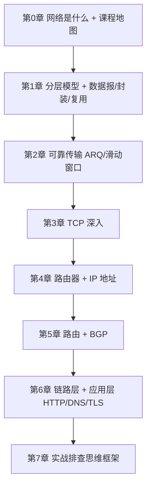
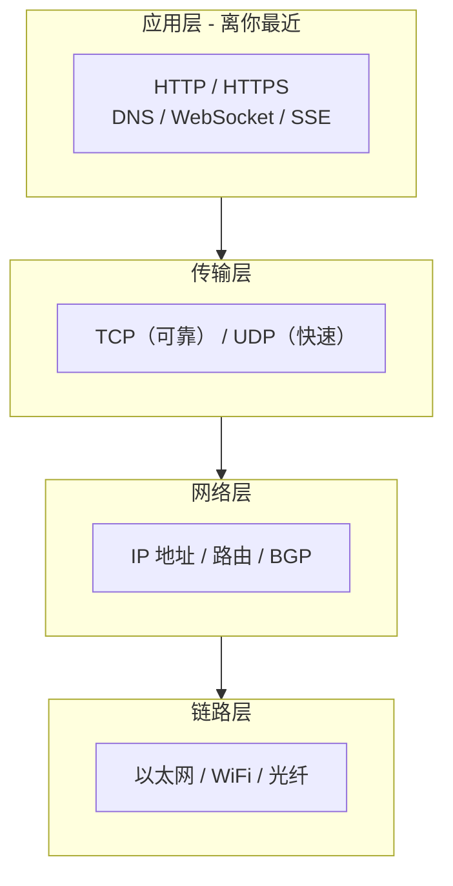

# CS144 计算机网络 · 学习笔记

> 来源：斯坦福 CS144《Introduction to Computer Networking》（[cs144.github.io](https://cs144.github.io/)）
> 学习者背景：零计算机基础 · 目标岗位：AI Engineer
> 讲解风格：类比 + 生活化 · 实用导向，跳过纯学术推导

## 这是做什么的

这是一份**跟着斯坦福 CS144 课程一步步学习计算机网络的笔记**。它和一般教材不同：

- 每一章都有**知识框架图**（Mermaid 图），帮你先看全局再看细节
- 只讲**对 AI 工程师工作真正有用**的东西
- 记录我学习过程中**真正卡住、想不明白的问题**，以及它们的答案

## 我为什么（作为 AI 工程师）要学网络

你未来写代码、调 API、部署模型，几乎每一步都会碰到网络：

| 你会做的事 | 需要懂的网络知识 |
|---|---|
| 调用 GPT/Claude 等大模型 API | HTTP、HTTPS、流式输出（SSE） |
| 排查"为什么接口这么慢" | 延迟 vs 带宽、TCP、连接复用 |
| 部署模型到服务器/容器 | IP 地址、端口、DNS、NAT |
| 让全球用户都能访问你的服务 | CDN、负载均衡、路由 |
| 理解安全与隐私 | TLS 加密、证书、防火墙 |

所以这不是一门"理论课"，而是一套**你每天都在用、却一直没真正看懂的底层逻辑**。

## 课程地图

### 分层视角：一张图看懂全书

> 核心思想：**每一层只做自己该做的事，向上一层提供"服务"，把麻烦藏在自己内部。** 就像寄快递——你只管写好地址（应用层），快递公司负责打包（传输层）、分拣路线（网络层）、开车送货（链路层）。

## 章节目录

- [第 0 章：网络是什么 + 学习方法](./00-课程地图与学习方法.md)
- [第 1 章：分层模型 + 数据报/封装/复用](./01-网络分层与数据报.md)
- [第 2 章：可靠传输（ARQ、滑动窗口）](./02-可靠传输.md)
- [第 3 章：TCP 深入](./03-TCP深入.md)
- [第 4 章：路由器 + IP 地址](./04-路由器与IP地址.md)
- [第 5 章：路由 + BGP](./05-路由与BGP.md)
- [第 6 章：链路层 + 应用层（HTTP/DNS/TLS）](./06-链路层与应用层.md)
- [第 7 章：实战排查思维框架](./07-实战排查思维框架.md)

## 使用说明

- 每章的笔记底部都有一个 **「我不懂的点 & 问答记录」** 板块，是我边学边积累的真实困惑，比正文更有参考价值。
- 框架图用 [Mermaid](https://mermaid.js.org/) 语法书写，在 GitHub 上能直接渲染成图。
- **术语约定**：所有关键术语都采用「中文 English」中英对照格式（例如：应用层 Application Layer、端口 Port、封装 Encapsulation），方便阅读英文文档/论文。
