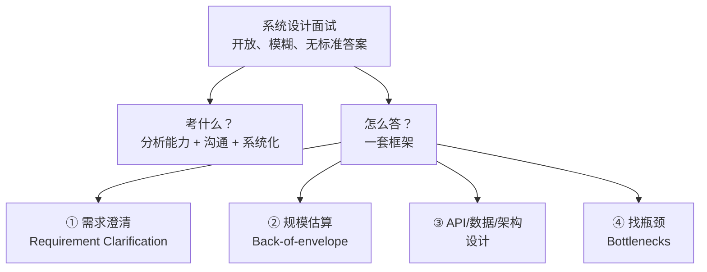

# 第 0 章：面试方法论 + 框架

> 本章目标：理解系统设计面试到底在考什么，掌握一套通用的解题框架。
> 你已经在 CS144 第 8 章学过 7 步模板，本章是《Grokking》的官方方法论，两者互补。

## 一、知识框架图（先看这个）



## 二、系统设计面试考什么？

**不是考"会不会背标准答案"，而是考"分析模糊问题的能力"。**

| 考察点 | 面试官在看什么 |
|---|---|
| **分析能力** | 会不会把一个模糊问题拆解清楚 |
| **沟通能力** | 会不会边想边说、带面试官一起走 |
| **系统化** | 有没有一套清晰的思路，还是东一榔头西一棒子 |
| **权衡能力** | 会不会做取舍（CAP、一致性 vs 可用性） |

> 核心：《Grokking》反复强调——**面试官要的是"你如何思考的过程"，不是"最终的标准答案"。**

## 三、通用解题框架（《Grokking》官方方法）

### ① 需求澄清（Requirement Clarification）——最重要！

**不要急着画图，先问清楚。**

```
问什么：
  - 功能需求：这个系统要做什么？
  - 用户规模：多少人用？日活多少？
  - 读写比例：读多还是写多？
  - 延迟要求：要多快？
  - 一致性 vs 可用性：哪个优先？
```

> 《Grokking》的警告：**"任何不先澄清需求就跳到方案的候选人，都会掉进陷阱。"**

### ② 规模估算（Back-of-the-envelope）

算 QPS、存储、带宽（你已学过，这里不再展开）。

### ③ 设计（API + 数据模型 + 架构）

- API：方法、URL、参数
- 数据模型：存什么、用什么数据库
- 高层架构：组件 + 连接

### ④ 找瓶颈（Identifying Bottlenecks）

**找出瓶颈，逐一解决**（这是 scale 的关键）：

```
常见瓶颈：
  - 读 QPS 高 → 缓存 + 多副本
  - 存储大 → 分片
  - 单点故障 → 冗余
  - 热点 → 本地缓存 + 多副本
```

## 四、面试的"心法"（《Grokking》原文要点）

| 心法 | 说明 |
|---|---|
| **边想边说** | 带面试官一起走，不要闷头画图 |
| **拆解问题** | 把大问题拆成小模块，逐个击破 |
| **主动引导** | 你主导对话的深度和方向 |
| **先广后深** | 先画整体，再深入关键组件 |
| **讲权衡** | 每个选择都说"为什么、代价是什么" |

## 五、和你已学内容的对应关系

| 《Grokking》框架 | 你 CS144 第 8 章已学的 |
|---|---|
| ① 需求澄清 | ✅ 第 1 步 |
| ② 规模估算 | ✅ 第 2 步 |
| ③ 设计 | ✅ 第 3~5 步 |
| ④ 找瓶颈 | ✅ 第 7 步 |

> 结论：**你已经掌握了这套框架**。《Grokking》的价值在于——后面 10 个基础概念 + 15 个案例，让你"弹药充足"，任何题都能套框架答。

## 六、本章自检

- [ ] 系统设计面试考什么？
- [ ] 通用框架有哪几步？哪一步最重要？
- [ ] 为什么"先澄清需求"是关键？
- [ ] 常见瓶颈有哪些？分别怎么解决？

## 七、自检答案

**① 考什么：** 分析模糊问题的能力 + 沟通 + 系统化 + 权衡，不是背标准答案。

**② 框架：** 需求澄清 → 规模估算 → 设计 → 找瓶颈。最重要是"需求澄清"。

**③ 为什么澄清是关键：** 问题模糊，不澄清规模/读写比/一致性就无法设计；直接跳方案会掉坑。

**④ 常见瓶颈：** 读 QPS 高→缓存+副本；存储大→分片；单点→冗余；热点→本地缓存。

---

## 我不懂的点 & 问答记录

> 记录我学习时的真实困惑与答案。

_（暂无——等你提问后我来补充）_
