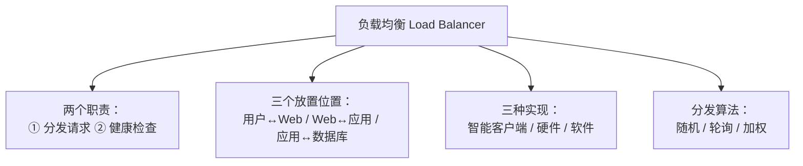
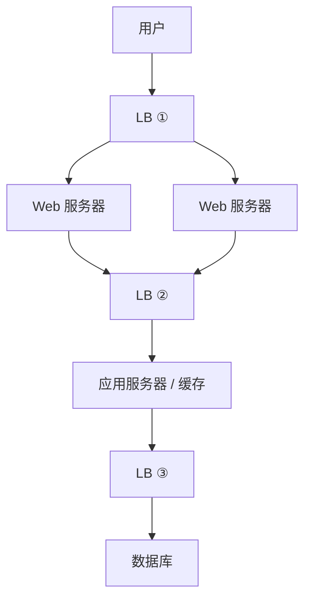

# 第 1 章：负载均衡 Load Balancing（深度版）

> 本章目标：彻底理解负载均衡——不只是"分发请求"，还包括健康检查、三个放置位置、三种实现方式。
> 这是《Grokking》里比入门版深得多的内容。

## 一、知识框架图（先看这个）

## 二、负载均衡的两个职责（你漏掉了一个！）

你之前以为 LB 只是"分发请求"，其实它有两个职责：

| 职责 | 说明 |
|---|---|
| **① 分发请求** | 按某种规则把请求分给多台服务器 |
| **② 健康检查（Health Check）** | **跟踪每台服务器状态，不健康的自动摘除！** |

**健康检查**：如果某台服务器挂了、不响应、或错误率飙升，LB 就**停止往它发流量**。等它恢复了，再重新加回来。

> 类比：餐厅前台不只是"分桌"，还会**观察哪个服务员生病了**（健康检查），生病的暂停接客，病好了再上岗。

## 三、LB 的三个放置位置（深度！）

**LB 不只放在"用户和服务器之间"，可以放在系统的每一层：**

| 位置 | 放在谁之间 | 作用 |
|---|---|---|
| **LB ①** | 用户 ↔ Web 服务器 | 第一道入口，扛用户流量 |
| **LB ②** | Web ↔ 应用/缓存 | 内部分发 |
| **LB ③** | 应用 ↔ 数据库 | 数据层分发 |

> 核心：**在每一层都做负载均衡，才能充分扩展和冗余。** 不是只在入口放一个 LB。

## 四、三种实现方式（深度！）

### ① 智能客户端（Smart Client）

**客户端自己知道"服务器池"，自己做负载均衡。**

- 客户端维护一个服务器列表，自己挑一台发请求
- 还能检测不响应的服务器，避开它

**特点**：简单、适合小系统。但系统大了，客户端逻辑变复杂，LB 要独立出来。

> 类比：你自己手里有张"餐厅服务员名单"，自己挑人下单。

### ② 硬件负载均衡（Hardware LB）

**买专用硬件（如 Citrix NetScaler）做负载均衡。**

- 性能极高，但**非常贵**、配置复杂
- 大公司也只在"入口"用硬件，内部用别的

> 类比：雇一个"专业领班"专门负责分桌，贵但专业。

### ③ 软件负载均衡（Software LB）—— 最常用！

**用软件（如 HAProxy、Nginx）做负载均衡。**

- 免费开源、灵活、够用
- HAProxy 还能做健康检查、自动增删服务器
- **大多数系统从软件 LB 起步**，需要时再升级

> 类比：用"免费的排队叫号软件"，而不是雇领班或买专业设备。

### 三种对比

| | 智能客户端 | 硬件 LB | 软件 LB |
|---|---|---|---|
| 成本 | 低 | 极高 | 低 |
| 性能 | 一般 | 极高 | 高 |
| 复杂度 | 客户端变复杂 | 配置复杂 | 适中 |
| 何时用 | 小系统 | 入口（大流量） | **起步首选** |

## 五、分发算法（比轮询更多）

| 算法 | 英文 | 说明 |
|---|---|---|
| 随机 | Random | 随机挑一台 |
| 轮询 | Round-robin | 轮流 1→2→3→1... |
| **加权** | Weighted | **按 CPU/内存利用率**，能力强的多分 |

> 加权：有的服务器性能强（CPU/内存多），就多分点流量给它。这才是"聪明"的负载均衡。

## 六、对 AI 工程师有什么用

1. **云上 LB**：AWS ALB/ELB、阿里云 SLB，都是软件 LB，你部署服务时会用到。
2. **健康检查**：理解"为什么某台服务器挂了，流量会自动切走"。
3. **三层放置**：理解系统里不只入口有 LB，内部也有。
4. **面试深挖点**：三种实现方式、健康检查、加权算法——这些是"深刻理解"和"表面了解"的分水岭。

## 七、本章自检

- [ ] LB 的两个职责是什么？（你以前漏了哪个？）
- [ ] LB 的三个放置位置是什么？
- [ ] LB 的三种实现方式？各自优缺点？
- [ ] 分发算法有哪些？加权是什么？

## 八、自检答案

**① 两个职责：** ① 分发请求；② 健康检查（跟踪服务器状态，不健康摘除）。以前漏了"健康检查"。

**② 三个位置：** 用户↔Web、Web↔应用/缓存、应用↔数据库。

**③ 三种实现：** 智能客户端（小系统）、硬件 LB（贵、入口用）、软件 LB（HAProxy/Nginx，起步首选）。

**④ 算法：** 随机、轮询、加权（按 CPU/内存利用率，能力强的多分）。

---

## 我不懂的点 & 问答记录

> 记录我学习时的真实困惑与答案。

_（暂无——等你提问后我来补充）_
