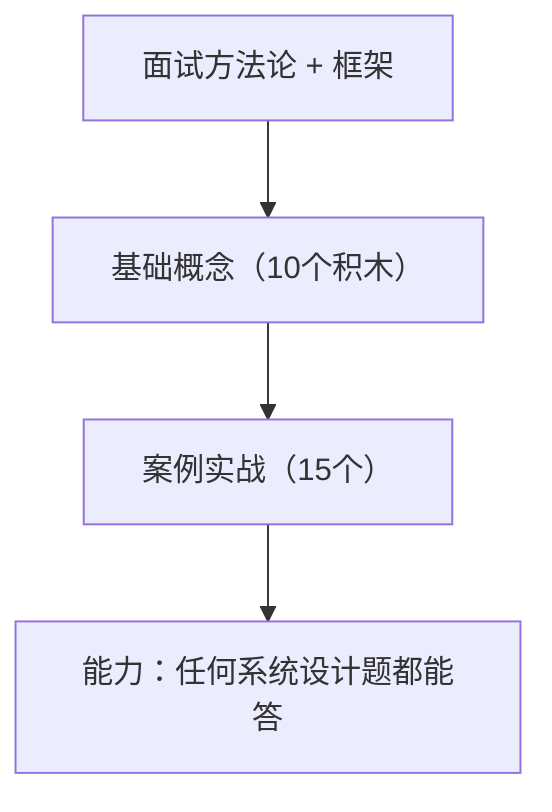

# Grokking the System Design Interview · 学习笔记

> 来源：《Grokking the System Design Interview》（DesignGurus，80 美元课程全套阅读材料）
> 学习者背景：零计算机基础 → 已完成 CS144 网络 + CS61B 数据结构 + System Design 入门（URL 短链接案例）
> 目标岗位：AI Engineer
> 讲解风格：类比 + 生活化 · 实用导向 · 术语中英对照

## 这份笔记是什么

这是**系统设计面试的"完整通关笔记"**，延续之前 CS144 / CS61B 的风格：

- 每章有**知识框架图**（Mermaid）
- 只讲**面试真的会考、工作真的会用**的东西
- 记录学习过程中的**真实困惑与解答**
- 每章有**自测题 + 答案**

> 说明：你之前在 CS144 笔记第 8 章已经做过 URL 短链接的完整案例。这份笔记是**更系统、更全面**的版本——涵盖全部基础概念 + 15 个经典案例。

## 课程地图（两大板块）

### 板块一：基础概念（Building Blocks，10 个积木）

| 积木 | 英文 | 一句话 |
|---|---|---|
| 负载均衡 | Load Balancing | 把请求分给多台机器 |
| 缓存 | Caching | 热点数据放快的地方 |
| 一致性哈希 | Consistent Hashing | 加机器时少迁移数据 |
| CAP 定理 | CAP Theorem | 一致性/可用性/分区容错 |
| 数据分区 | Data Partitioning | 数据切分到多台机器 |
| 索引 | Indexes | 加速数据库查找 |
| 代理 | Proxies | 客户端和服务器的中间人 |
| 冗余与复制 | Redundancy & Replication | 多副本防单点 |
| SQL vs NoSQL | SQL vs NoSQL | 关系型 vs 非关系型 |
| 长轮询/WebSocket/SSE | Long-Polling/WS/SSE | 实时通信三选一 |

### 板块二：案例实战（Case Studies，15 个）

| 案例 | 英文 | 核心考点 |
|---|---|---|
| URL 短链接 | URL Shortening | 短码生成、哈希 |
| Pastebin | Pastebin | 文本存储、唯一 key |
| Instagram | Instagram | 图片、Feed |
| Dropbox | Dropbox | 文件同步、去重 |
| Messenger | Facebook Messenger | 聊天、实时 |
| Twitter | Twitter | 新闻流、名人粉丝 |
| YouTube | YouTube | 视频、CDN |
| 自动补全 | Typeahead Suggestion | Trie、前缀 |
| API 限流 | API Rate Limiter | 限流算法 |
| 搜索 | Twitter Search | 全文索引 |
| 爬虫 | Web Crawler | 广度爬取、去重 |
| 信息流 | Facebook Newsfeed | Feed 聚合 |
| 附近服务 | Yelp / Nearby | 地理位置 |
| 网约车 | Uber | 实时位置匹配 |
| 票务 | Ticketmaster | 秒杀、超卖 |

## 章节目录

- [第 0 章：面试方法论 + 框架](./00-面试方法论与框架.md)
- [第 1 章：负载均衡](./01-负载均衡.md)
- [第 2 章：缓存](./02-缓存.md)
- [第 3 章：一致性哈希](./03-一致性哈希.md)
- [第 4 章：CAP 定理](./04-CAP定理.md)
- [第 5 章：数据分区](./05-数据分区.md)
- [第 6 章：索引](./06-索引.md)
- [第 7 章：代理](./07-代理.md)
- [第 8 章：冗余与复制](./08-冗余与复制.md)
- [第 9 章：SQL vs NoSQL](./09-SQL与NoSQL.md)
- [第 10 章：长轮询 / WebSocket / SSE](./10-实时通信.md)
- 案例篇（URL 短链接、Pastebin、Instagram...）— *陆续更新*

## 使用说明

- 每章有「自测题 + 答案」和「我不懂的点 & 问答记录」。
- 术语采用「中文 English」中英对照。
- 框架图用 Mermaid，GitHub 直接渲染。
